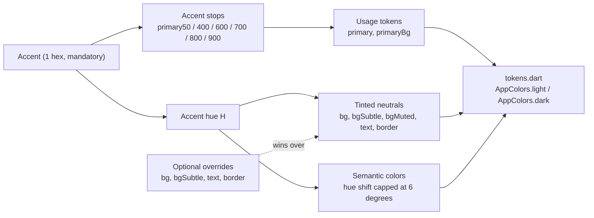
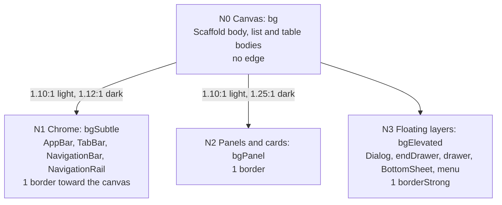
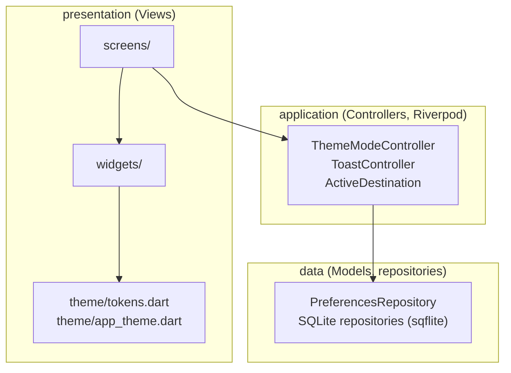

# Design System - v2.1 (Flutter / Android)

> **Applies when `designSystem: framework` (Phase 1 default).** If `designSystem: native` was chosen, ignore this file for colors and components and follow `rules/native-design.md` (Material 3, `ColorScheme.fromSeed`); `AppTokens` (spacing, sizes, durations, `touchTarget`), the accessibility rules (§12) and the structural layout of `layout.md` stay shared.
> Binding reference for all Flutter/Dart Android applications.
> Inseparable from `layout.md` (v3.2).
> All tokens are Dart constants declared in `lib/presentation/theme/tokens.dart`, consumed exclusively by `app_theme.dart` and by widgets through the theme.
> Units: dimensions in **dp** (Flutter logical value), fonts in **sp** (follow the system setting).
> Stack: Android (minSdkVersion 24, latest stable targetSdk), Flutter stable, Dart 3, Riverpod 3 with code generation, strict layers `data` / `application` / `presentation`, `flutter_localizations` + gen-l10n (FR default, EN), `shared_preferences`, `flutter_lints`.

**Visual language (v2.1)**: depth is expressed by the **stroke** (borders) and by a **four-level surface ladder** (fills spaced widely enough to be seen), never by shadows or elevation. Corners are softly rounded (5). Neutrals carry a low tint of the project accent, so every generated application has its own atmosphere. Motion is discreet (asymmetric deceleration) with **one** signature gesture: the sliding underline of the top `TabBar` indicator (Material animates it natively). Every state is readable without color alone, and every text and control pair is checked against WCAG 2.1 AA.

## Changelog

| Version | Date       | Main change |
| ------- | ---------- | ----------- |
| v2.1    | 2026-10-25 | **surface ladder** N0-N3 (canvas / chrome / panel / floating) with wider fill steps · new token `bgPanel` · neutral hex recomputed (`bg`, `bgSubtle`, `bgMuted`, `bgElevated`, `border`, `borderSubtle`, `borderStrong`, `textSubtle`) · **accent AA darkening**: `primary600` is darkened until white text, text on `bg` and text on `primary50` reach 4.5:1 (default `#4682B4` → `#3D729E`); `primary700/800` re-derived from it · new token `dangerFill` · AppBar, NavigationBar, NavigationRail and TabBar on `bgSubtle`, dialog on `bgElevated` · control edge (field, Secondary button) = `borderStrong` · neutral hover step transparent → `borderStrong` (pointer only) · selected list and tree items carry a 2 `primary` leading bar, the NavigationBar indicator carries a 1 `primary` stroke · tree chevrons `textSubtle` · **inset focus ring** (Flutter draws the Material button border inside the shape, no offset): `text` color on filled buttons · Flutter-native substitutes made explicit: real opacity (`opacityDisabled`, `opacityOverlay`) instead of pre-blended colors, `Semantics(liveRegion: true)` for danger toasts, modal routes for focus containment, `MediaQuery.disableAnimationsOf` for reduced motion · Dart 3 / Material 3 API names (`WidgetState`, `Color.withValues`, `CardThemeData`, `DialogThemeData`, `TabBarThemeData`) · Riverpod 3 conventions · computed sizes (§4) · section 14 lists what was not run on a device |
| v2.0    | 2026-07-16 | modernization: `radius` 0 → **5** · **accent-tinted neutrals** (all neutral roles derived from the accent hue; explicit palette roles still win) · **semantic colors derived per project** (fixed hue anchors, harmonized ±6° toward the accent; info = accent) · pointer hover = **border strengthening** (touch keeps the `bgMuted` pressed highlight) · easing `easeOut` (`Curves.easeOutCubic`) 160/240ms · **signature gesture**: sliding `TabBar` indicator underline · icons Font Awesome → **Lucide** (`lucide_icons_flutter`); `icon*` tokens alias the derived tokens · floating layers marked by `borderStrong` (shadows/elevation still forbidden) |
| v1.6    | 2026-06-27 | default accent → **Steel Blue** `#4682B4` (chromatic in both themes, derived like the named palettes) · dark **surfaces** stay neutral grey · `onPrimary` stays a single white value · Teal kept as a named palette |
| v1.5    | 2026-06-20 | default accent → **Teal** `#0D9488` · dark surfaces stay neutral grey · grey-accent dark special-case removed |
| v1.4    | 2026-06-20 | decouple Danger button text from the accent: new fixed `onDanger` token |
| v1.3    | 2026-06-19 | full **palette** model (5 roles/theme) · named palette catalog + custom palette · WCAG AA check (warn) |
| v1.2    | 2026-06-14 | dark theme re-skin: 4-step dark surface ramp · Steel Blue primary (both modes) |
| v1.1    | 2026-06-14 | line-height · dark semantic backgrounds · WCAG AA target · overlay layering |
| v1.0    | initial    | Dart-token port: typography, colors, spacing, components, states (touchTarget, sp units) |

> This file shares the palette, the derivation model and every token value with the Electron `design-system.md v2.1` and the Python `design-system.md v2.1`. Only the mechanics differ (Dart constants and `ThemeData` instead of CSS custom properties or QSS). Per-file versions: theme rules in `rules/theme.md`, layout in `layout.md`.

Every generated application references the active version in its `README.md`.

## Deviations from v2.0

Each row is a value or rule of v2.0 that v2.1 replaces, with the reason.

| Area | v2.0 | v2.1 | Reason |
| ---- | ---- | ---- | ------ |
| `primary600` | `#4682B4` (the accent) | `#3D729E` (accent darkened, L 49 → 43) | white text, `primary` on `bg` and on `primary50` reach 4.5:1 (were 4.11, 4.07, 3.67) |
| `primary400` | `#5A9FD4` | `#91B6D4` | dark foreground accent re-derived at L≈70 % so selected text, ring and underline read on the new dark surfaces (8.60:1 on `bg`) |
| `primary700`, `primary800` | L≈50 and L≈42 | `primary600` minus 3 and 6 L | pressed was lower in contrast than the resting state |
| `primary900` | `#2A4F72` | `#24425C` | dark selected background tuned to the new dark ramp |
| Primary and Danger states | pressed = `primary700` / `danger700`; no hover | pointer hover = `primary700` / `danger700`; pressed = `primary800` / `danger800` | pressed must be the deepest step, and hover exists on pointer devices (ChromeOS, mouse) |
| `textSubtle` | `#65717B` / `#94A2AD` | `#5A6670` / `#A3AEB8` | 4.5:1 on selected and toast surfaces (were 4.41 to 4.47) |
| `borderStrong` | `#96A4B0` / `#52626F` | `#6F8192` / `#768A9B` | 3:1 on every surface, `bgMuted` included (was 2.5:1) |
| Neutral surfaces | light `#FDFEFF`, `#F5F8FA`, `#EEF1F4`; dark `#181C20`, `#20272C`, `#293138`, `#252C32` | light `#FFFFFF`, `#F1F4F7`, `#E6EBF0`; dark `#111519`, `#1A2025`, `#2B343C`, `#222930` (`bg`, `bgSubtle`, `bgMuted`, dark `bgElevated`) | fills were 1.06 to 1.13:1 apart and merged; wider steps carry the surface ladder |
| `border`, `borderSubtle` | light `#E1E6EA`, `#ECF0F3`; dark `#323B43`, `#272F35` | light `#D3DAE1`, `#E3E8ED`; dark `#3A444D`, `#2A333A` | `border` on `bg` was 1.24:1 and 1.50:1, now 1.41:1 and 1.85:1 |
| `bgPanel` | not defined | `bgSubtle` light, `bgElevated` dark | panel and card level N2 needs a different step per theme |
| AppBar, NavigationBar, NavigationRail fill | `bg` | `bgSubtle` | chrome sits one level above the canvas |
| Dialog fill | `bg` | `bgElevated` | floating layer level N3; identical in light, one step lighter in dark |
| Danger fill | `danger600` (light value in both themes, by prose) | token `dangerFill` = light `danger600` | the dark `danger600` (`#CB7282`) fails white text; a named token removes the ambiguity |
| Control edge | `border` | `borderStrong` | WCAG 1.4.11: field and Secondary button boundary (was 1.24:1) |
| Neutral hover step (pointer) | transparent → `border` | transparent → `borderStrong`; bordered control → `textSubtle` | the system's own 3:1 hover rule |
| Selected item | background and content color | plus a 2 `primary` leading bar (list, tree, drawer item); NavigationBar indicator gets a 1 `primary` stroke | WCAG 1.4.1: no color-only state |
| Tree chevrons | `textSubtle` | unchanged, now recorded as a rule | a functional icon is not exempt from AA |
| Disabled state | `opacityDisabled` 0.4 | unchanged: Flutter has real opacity, applied with `Color.withValues(alpha:)` or `Opacity` | no pre-blended colors needed, unlike QSS |
| Overlay | `text` 0.4 | unchanged (`scrimColor` / `barrierColor` = `text.withValues(alpha: opacityOverlay)`) | idem |
| Focus ring | 2 `primary`, offset 2 | 2 ring drawn inside the control (`BorderSide`, inside alignment); `text` color on Primary and Danger buttons | `ButtonStyle` has no outline offset; an inset ring on a filled button must contrast with the fill, `primary` on `primary600` would be 1:1 |
| Token classes | `LightColors` and `DarkColors` implementing `AppColors` | one `AppColors` `ThemeExtension` with two constants `AppColors.light` and `AppColors.dark` | a `ThemeExtension` needs `copyWith` and `lerp` once, not twice; the theme switch is instant, so `lerp` snaps |
| Component themes | `CardTheme`, `DialogTheme`, `TabBarTheme` | `CardThemeData`, `DialogThemeData`, `TabBarThemeData` | `ThemeData` takes the `*ThemeData` types since Flutter 3.27 |
| Color opacity | `withOpacity` | `withValues(alpha:)` | `withOpacity` is deprecated |
| Button states | `MaterialStateProperty` | `WidgetStateProperty` | `MaterialState` was renamed `WidgetState` |

---

## 1. TYPOGRAPHY

| Token            | Value | Usage                          |
| ---------------- | ----- | ------------------------------ |
| `fontFamily`     | system font (Roboto on Android, the Flutter default, no pinned family) | All applications |
| `fontXs`         | 12    | Secondary labels, captions     |
| `fontSm`         | 14    | Labels, subtitles, body        |
| `fontBase`       | 16    | Primary text, navigation       |
| `fontLg`         | 18    | Secondary section titles, dialog and drawer titles |
| `font2xl`        | 24    | Primary section titles         |
| `weightNormal`   | `FontWeight.w400` | Body, descriptions |
| `weightMedium`   | `FontWeight.w500` | Labels, navigation items |
| `weightSemibold` | `FontWeight.w600` | Titles, headers    |
| `weightBold`     | `FontWeight.w700` | Primary titles     |

> Do not pin a font family: Flutter's default resolves to the Android system face. Zero embedded font, zero dependency; the application always looks native to its OS.

### Line-height

Applied via the `height` property of `TextStyle` (multiplier of font size).

| Token           | Value | Usage                          |
| --------------- | ----- | ------------------------------ |
| `leadingTight`  | 1.25  | Titles (`fontLg`, `font2xl`)   |
| `leadingNormal` | 1.5   | Body, labels                   |

> Scale note: the step from `fontLg` (18) to `font2xl` (24) is wider than the lower steps. No `fontXl` (20) token is defined (no current usage); do not add one speculatively.

### Mapping to the Material `TextTheme`

`app_theme.dart` fills the `TextTheme` slots from the tokens, so Material widgets that read a slot inherit the system. A slot that is not listed keeps the Material default and must not appear in the application.

| `TextTheme` slot | Token set | Used by |
| ---------------- | --------- | ------- |
| `headlineMedium` | `font2xl`, `weightBold`, `leadingTight` | Section header title |
| `titleLarge`     | `fontLg`, `weightSemibold`, `leadingTight` | Dialog, drawer and sheet titles |
| `titleMedium`    | `fontBase`, `weightSemibold`, `leadingNormal` | AppBar title |
| `bodyLarge`      | `fontBase`, `weightNormal`, `leadingNormal` | Primary text |
| `bodyMedium`     | `fontSm`, `weightNormal`, `leadingNormal` | Body, subtitles, list secondary line |
| `labelLarge`     | `fontSm`, `weightMedium`, `leadingNormal` | Buttons `md`, tabs, field labels |
| `labelMedium`    | `fontXs`, `weightMedium`, `leadingNormal` | Buttons `sm`, NavigationBar labels |
| `bodySmall`      | `fontXs`, `weightNormal`, `leadingNormal` | Toast description, helper and error text |

### Numerals

Tables, counters, and any column of figures set `FontFeature.tabularFigures()` on their `TextStyle` so digits align vertically, and right-align the column.

```dart
// presentation/theme/app_theme.dart - token: fontSm / weightNormal / leadingNormal
const figures = [FontFeature.tabularFigures()];
final amount = textTheme.bodyMedium!.copyWith(fontFeatures: figures);
```

---

## 2. COLORS

Declaration: one `AppColors` class, a `ThemeExtension<AppColors>`, with two constants `AppColors.light` and `AppColors.dark`, injected into each `ThemeData` through `extensions:`. Widgets read it with `context.colors`.

A project's colors come from a **palette**. Only the **accent is mandatory**: every neutral role, the accent stops, and the semantic colors **derive** from it. The four other roles (main background, secondary background, text, details) remain available as **explicit overrides**: when provided, their values win over the derivation.



### Palette roles → tokens

| Role (palette)      | Mandatory | Drives       | Also derives |
| ------------------- | --------- | ------------ | ------------ |
| Accent              | yes       | `primary600` (after the AA darkening below) | `primary50/400/700/800/900`, `primary`, `primaryBg`, `selectionBg`, `cursorColor`, `onPrimary`, **all neutral tokens** (tinting rule below), **all semantic tokens** (harmonization rule below) |
| Main background     | optional  | `bg`         | `bgElevated` (= `bg` in light), `bgPanel` |
| Secondary background| optional  | `bgSubtle`   | `bgMuted` (`bgSubtle` darkened ~3.5 % L) |
| Text                | optional  | `text`       | `textSubtle` (mix text→bg ~45 %), `textMuted` (mix text→bg ~62 %) |
| Details             | optional  | `border`     | `borderSubtle` (mix border→bg ~50 %), `borderStrong` (mix border→text ~12 %) |

### Derivation rules (computed by Claude in Phase 1, written as literal `Color(0xFF…)` in `tokens.dart`)

**Accent stops** (same H/S as the accent, lightness varies): `primary50` L≈95 %, `primary400` L≈70 %, `primary900` L≈25 %.

**AA darkening (new in v2.1).** `primary600` is the accent, darkened in steps of 1 % lightness until three pairs all reach 4.5:1: white on it, it on `bg`, and it on `primary50`. An accent that already passes keeps its value. `primary700` is `primary600` minus 3 % L and `primary800` minus 6 % L, so pressed stays visible and never loses contrast. `onPrimary` is `#FFFFFF`: after the darkening, white always passes. Same `colorsys` method as the Python generator.

Usage tokens: `primary` = `primary600` (light) / `primary400` (dark); `primaryBg` = `primary50` (light) / `primary900` (dark).

**Tinted neutrals.** Let **H** be the accent hue. Every neutral token is `hsl(H, S, L)` with the fixed S/L targets below. The tint is atmospheric, never saturated: S stays ≤ 33 % in light, ≤ 24 % in dark. When an optional palette role is provided, its explicit value replaces the tinted target for that token, and its supporting tokens derive from it by the mix rules of the role table above.

| Token          | Light `hsl(H, S%, L%)` | Dark `hsl(H, S%, L%)` |
| -------------- | ---------------------- | --------------------- |
| `bg`           | 0, 100                 | 19, 8                 |
| `bgSubtle`     | 27, 96                 | 17, 12                |
| `bgElevated`   | = `bg`                 | 17, 16                |
| `bgMuted`      | 25, 92                 | 17, 20                |
| `bgPanel`      | = `bgSubtle`           | = `bgElevated`        |
| `text`         | 33, 9                  | 24, 96                |
| `textSubtle`   | 11, 40                 | 13, 68                |
| `textMuted`    | 12, 64                 | 11, 42                |
| `border`       | 19, 86                 | 14, 26                |
| `borderSubtle` | 22, 91                 | 16, 20                |
| `borderStrong` | 14, 50                 | 16, 54                |

> Light `bg` is pure white (S 0): the tint lives in the surfaces beneath it. Dark surface ramp stays ascending: `bg` < `bgSubtle` < `bgElevated` < `bgMuted`, so the pressed highlight stays visible on every surface, including inside drawers and sheets.

### Surface ladder

Depth is the fill and the stroke together. Four levels, each with an assigned fill and edge.



| Level | Role | Light | Dark | Edge | Flutter surface |
| ----- | ---- | ----- | ---- | ---- | --------------- |
| N0 | Canvas: screen body, list and table bodies | `bg` | `bg` | none | `Scaffold.backgroundColor` |
| N1 | Chrome: AppBar, TabBar, NavigationBar, NavigationRail | `bgSubtle` | `bgSubtle` | 1 `border` toward the canvas | `AppBarTheme`, `NavigationBarThemeData`, `NavigationRailThemeData` |
| N2 | Panels and cards | `bgPanel` (`bgSubtle`) | `bgPanel` (`bgElevated`) | 1 `border` | `CardThemeData`, `AppPanel` widget |
| N3 | Floating layers: dialog, endDrawer, bottom sheet, menu | `bgElevated` (= `bg`) | `bgElevated` | 1 `borderStrong` | `DialogThemeData`, `DrawerThemeData`, `BottomSheetThemeData`, `PopupMenuThemeData` |

- Chrome frames the canvas: never put an AppBar or NavigationBar on `bg`.
- A list body stays on `bg`. On a panel, frame it with a 1 `border`.
- Measured steps from the canvas (contrast ratio of the fill against `bg`, computed): chrome 1.10:1 light and 1.12:1 dark, panel 1.10:1 and 1.25:1, `bgMuted` 1.20:1 and 1.45:1, `border` 1.41:1 and 1.85:1.
- In light, `primaryBg` on `bgSubtle` is 1.01:1, so a selected item on chrome or on a panel is told by its 2 `primary` bar and its `primary` content, never by the fill.
- Mobile has no statusbar: `bgMuted` is reserved for the pressed highlight.

### Default palette - Steel Blue accent `#4682B4` (H = 207), computed hex

Light (`AppColors.light`):

| Token          | Value   | Token          | Value   |
| -------------- | ------- | -------------- | ------- |
| `bg`           | #FFFFFF | `text`         | #0F181E |
| `bgSubtle`     | #F1F4F7 | `textSubtle`   | #5A6670 |
| `bgMuted`      | #E6EBF0 | `textMuted`    | #98A4AE |
| `bgElevated`   | #FFFFFF | `border`       | #D3DAE1 |
| `bgPanel`      | #F1F4F7 | `borderSubtle` | #E3E8ED |
| -              | -       | `borderStrong` | #6F8192 |

Dark (`AppColors.dark`, derived):

| Token          | Value   | Token          | Value   |
| -------------- | ------- | -------------- | ------- |
| `bg`           | #111519 | `text`         | #F2F5F7 |
| `bgSubtle`     | #1A2025 | `textSubtle`   | #A3AEB8 |
| `bgElevated`   | #222930 | `textMuted`    | #5F6C77 |
| `bgMuted`      | #2B343C | `border`       | #3A444D |
| `bgPanel`      | #222930 | `borderSubtle` | #2A333A |
| -              | -       | `borderStrong` | #768A9B |

> Hex values are computed from the HSL targets and the AA darkening; re-check with a contrast tool before shipping (Phase 1 runs the AA check, §12).

### Named palettes (Phase 1 catalog)

`/flutter-p1-scoping` presents these. A preset is defined by its **accent alone**; the four optional roles may still be listed to override the tint (e.g. Amber warms its backgrounds beyond the rule). The accent is the source color; `primary600` is the value after the AA darkening. Custom palettes: 1 mandatory hex (accent) + up to 4 optional overrides.

| Name                 | Accent  | `primary600` | White on `primary600` | `primary600` on `bg` | Optional overrides                    |
| -------------------- | ------- | ------------ | --------------------- | -------------------- | ------------------------------------- |
| Steel Blue (default) | #4682B4 | #3D729E      | 5.12                  | 5.12                 | -                                     |
| Teal                 | #0D9488 | #0B7F74      | 4.88                  | 4.88                 | -                                     |
| Forest               | #059669 | #04805A      | 4.95                  | 4.95                 | -                                     |
| Slate                | #4F46E5 | #4F46E5      | 6.29                  | 6.29                 | -                                     |
| Amber                | #B45309 | #B45309      | 5.02                  | 4.95                 | Main bg #FFFDFB, Secondary bg #FBF6EF |
| Ruby                 | #BE123C | #BE123C      | 6.29                  | 6.29                 | -                                     |

> "Slate" is an indigo (hue 243), not a slate grey: the name comes from the original catalog. The non-default rows are carried over from the Python catalog (same derivation) and were not recomputed for Flutter.

### Accent - usage tokens

The stops are mode-agnostic: one value each, shared by `AppColors.light` and `AppColors.dark`; only the usage tokens flip. Replacing the 6 `primary*` values in `tokens.dart` (+ regenerating the derived neutrals and semantics) changes the accent across the whole application.

| Token        | Value   | Usage                                                     |
| ------------ | ------- | --------------------------------------------------------- |
| `primary50`  | #EDF3F8 | Selection / active bg (light)                             |
| `primary400` | #91B6D4 | Active content (dark): reads on the dark `bg`             |
| `primary600` | #3D729E | Primary button fill (both themes); active content (light) |
| `primary700` | #396A93 | Reserved: pointer hover of Primary (not used on touch)    |
| `primary800` | #356388 | Primary button pressed                                    |
| `primary900` | #24425C | Selection / active bg (dark)                              |

Derived usage tokens, defined per theme (the ones components consume):

| Token       | Light        | Dark         |
| ----------- | ------------ | ------------ |
| `primary`   | `primary600` | `primary400` |
| `primaryBg` | `primary50`  | `primary900` |

> v2.1 changes the pressed stop: Primary presses to `primary800` (6.38:1 with white), `primary700` (5.74:1) is the pointer hover. v2.0 pressed to `primary700`; both stay legible with `onPrimary`.

### Semantic colors (derived - harmonized with the project atmosphere)

Semantic colors keep **fixed hue anchors** so the meaning never drifts, but their exact hue/saturation/lightness are **derived per project** so they share the tinted atmosphere of the neutrals. **Info is the accent itself.**

**Derivation rule.** Let **Ha** be the accent hue and **Hs** the anchor hue of a semantic color. The harmonized hue is:

```
Hs' = Hs + clamp(shortest_angle(Ha − Hs), −10°, +10°) × 0.6      → shift capped at ±6°
```

| Semantic | Anchor Hs | Light `*600` `hsl(Hs', S%, L%)` | Dark `*600` `hsl(Hs', S%, L%)` |
| -------- | --------- | -------------------------------- | ------------------------------- |
| success  | 152       | S 48, L 38                       | S 42, L 60                      |
| warning  | 38        | S 62, L 40                       | S 56, L 60                      |
| danger   | 355       | S 52, L 48                       | S 46, L 62                      |
| info     | = accent  | `info600` = `primary600`         | `info600` = `primary400`        |

**Surface tokens** (`*50`, toast backgrounds):
- Light: `*50` = sRGB mix of `bg` 92 % + `*600` 8 %.
- Dark: `*50` = sRGB mix of `bg` 82 % + dark `*600` 18 %.
- Info: `info50` = `primaryBg` (`primary50` light / `primary900` dark).

> The default-palette `*50` values below keep their v2.0 hex. They were not re-derived from the v2.1 `bg`; they still pass the pairs listed in §12.

> Naming note: `*50` is a **role** ("semantic surface / toast background"), not a fixed luminance level. Light = pale tint, dark = deep tint of the same hue, declared in each theme's constant. A toast keeps one coherent palette per theme: bg `*50`, text `text`, border and icon `*600`.

**Danger button stops**: the fill is the light `danger600` in **both** themes, exposed as the token `dangerFill`, with white `onDanger`. `danger700` = light `danger600` at L −7 %; `danger800` at L −13 %.

Default palette (accent H 207) computed hex:

| Token        | Light   | Dark    | Usage                  |
| ------------ | ------- | ------- | ---------------------- |
| `success50`  | #EFF6F3 | #26372F | Success toast bg       |
| `success600` | #328F6D | #6EC4A4 | Success border, icon   |
| `warning50`  | #F8F5EC | #392F1B | Warning toast bg       |
| `warning600` | #A58327 | #D2B460 | Warning border, icon   |
| `danger50`   | #F8EFF1 | #38222B | Danger toast bg        |
| `danger600`  | #BA3B52 | #CB7282 | Danger border, icon, error text |
| `dangerFill` | #BA3B52 | #BA3B52 | Danger button fill     |
| `danger700`  | #A23448 | #A23448 | Danger button pointer hover |
| `danger800`  | #8A2C3D | #8A2C3D | Danger button pressed  |
| `info50`     | = `primaryBg` | = `primaryBg` | Info toast bg   |
| `info600`    | = `primary` | = `primary` | Info border, icon   |

> The ±6° cap keeps every semantic color instantly recognizable across projects (a danger is always red-family, a success always green-family). Toast message text uses `text`; border and icon use `*600`. Every `*600`/`*50` pair must pass the §12 checks; Phase 1 verifies and reports. Pair every status color with a word or an icon shape.

### Charts / visualization palette

The chart tokens reference the themed tokens, so they follow light/dark with no redefinition.

| Token          | Value        |
| -------------- | ------------ |
| `chartPrimary` | `primary`    |
| `chartSuccess` | `success600` |
| `chartWarning` | `warning600` |
| `chartDanger`  | `danger600`  |
| `chartInfo`    | `info600`    |

- Hue alone never separates two series (success and danger differ by 1.4:1 in lightness): add a marker shape, a dash pattern or a direct label, and keep at least 1.5:1 of lightness between neighbouring series.
- `chartInfo` equals `chartPrimary` (info is the accent): never plot both in one chart.

### Text selection and on-primary

| Token           | Light        | Dark         | Usage                            |
| --------------- | ------------ | ------------ | -------------------------------- |
| `selectionBg`   | `primaryBg`  | `primaryBg`  | Text field selection background  |
| `cursorColor`   | `primary`    | `primary`    | Text field cursor                |
| `onPrimary`     | #FFFFFF      | #FFFFFF      | Text/icon on Primary button      |
| `onDanger`      | #FFFFFF      | #FFFFFF      | Text/icon on Danger button (fixed) |

> `onPrimary` and `onDanger` stay separate tokens so a custom accent dark enough to need a near-black `onPrimary` does not drag the Danger button along (the danger fill keeps white text in both themes). `selectionBg` and `cursorColor` go into `textSelectionTheme` in `app_theme.dart`.

### The `AppColors` extension

```dart
// lib/presentation/theme/tokens.dart
import 'package:flutter/material.dart';

/// Themed color tokens. Two constants, [light] and [dark]; widgets read them
/// with `context.colors`.
@immutable
final class AppColors extends ThemeExtension<AppColors> {
  const AppColors({
    required this.bg,
    required this.bgSubtle,
    required this.bgMuted,
    required this.bgElevated,
    required this.bgPanel,
    required this.text,
    required this.textSubtle,
    required this.textMuted,
    required this.border,
    required this.borderSubtle,
    required this.borderStrong,
    required this.primary,
    required this.primaryBg,
    required this.success50,
    required this.success600,
    required this.warning50,
    required this.warning600,
    required this.danger50,
    required this.danger600,
    required this.dangerFill,
    required this.onPrimary,
    required this.onDanger,
  });

  final Color bg, bgSubtle, bgMuted, bgElevated, bgPanel;
  final Color text, textSubtle, textMuted;
  final Color border, borderSubtle, borderStrong;
  final Color primary, primaryBg;
  final Color success50, success600, warning50, warning600, danger50, danger600;
  final Color dangerFill, onPrimary, onDanger;

  // Accent stops: one value, shared by both themes.
  static const Color primary50 = Color(0xFFEDF3F8);
  static const Color primary400 = Color(0xFF91B6D4);
  static const Color primary600 = Color(0xFF3D729E);
  static const Color primary700 = Color(0xFF396A93);
  static const Color primary800 = Color(0xFF356388);
  static const Color primary900 = Color(0xFF24425C);
  static const Color danger700 = Color(0xFFA23448);
  static const Color danger800 = Color(0xFF8A2C3D);

  // Aliases of derived tokens: no independent hex (design-system.md §10).
  Color get info50 => primaryBg;
  Color get info600 => primary;
  Color get iconDefault => textSubtle;
  Color get iconActive => primary;
  Color get iconSuccess => success600;
  Color get iconWarning => warning600;
  Color get iconDanger => danger600;
  Color get iconInfo => info600;
  Color get iconMuted => textMuted;
  Color get selectionBg => primaryBg;
  Color get cursorColor => primary;

  static const AppColors light = AppColors(
    bg: Color(0xFFFFFFFF),
    bgSubtle: Color(0xFFF1F4F7),
    bgMuted: Color(0xFFE6EBF0),
    bgElevated: Color(0xFFFFFFFF),
    bgPanel: Color(0xFFF1F4F7),
    text: Color(0xFF0F181E),
    textSubtle: Color(0xFF5A6670),
    textMuted: Color(0xFF98A4AE),
    border: Color(0xFFD3DAE1),
    borderSubtle: Color(0xFFE3E8ED),
    borderStrong: Color(0xFF6F8192),
    primary: primary600,
    primaryBg: primary50,
    success50: Color(0xFFEFF6F3),
    success600: Color(0xFF328F6D),
    warning50: Color(0xFFF8F5EC),
    warning600: Color(0xFFA58327),
    danger50: Color(0xFFF8EFF1),
    danger600: Color(0xFFBA3B52),
    dangerFill: Color(0xFFBA3B52),
    onPrimary: Color(0xFFFFFFFF),
    onDanger: Color(0xFFFFFFFF),
  );

  static const AppColors dark = AppColors(
    bg: Color(0xFF111519),
    bgSubtle: Color(0xFF1A2025),
    bgMuted: Color(0xFF2B343C),
    bgElevated: Color(0xFF222930),
    bgPanel: Color(0xFF222930),
    text: Color(0xFFF2F5F7),
    textSubtle: Color(0xFFA3AEB8),
    textMuted: Color(0xFF5F6C77),
    border: Color(0xFF3A444D),
    borderSubtle: Color(0xFF2A333A),
    borderStrong: Color(0xFF768A9B),
    primary: primary400,
    primaryBg: primary900,
    success50: Color(0xFF26372F),
    success600: Color(0xFF6EC4A4),
    warning50: Color(0xFF392F1B),
    warning600: Color(0xFFD2B460),
    danger50: Color(0xFF38222B),
    danger600: Color(0xFFCB7282),
    dangerFill: Color(0xFFBA3B52),
    onPrimary: Color(0xFFFFFFFF),
    onDanger: Color(0xFFFFFFFF),
  );

  /// Tokens are constants: nothing to override per instance.
  @override
  AppColors copyWith() => this;

  /// The theme switch is instant (`themeAnimationDuration: Duration.zero`),
  /// so interpolation snaps.
  @override
  AppColors lerp(ThemeExtension<AppColors>? other, double t) =>
      other is AppColors && t >= 0.5 ? other : this;
}

extension AppColorsContext on BuildContext {
  /// Active color tokens of the current theme.
  AppColors get colors => Theme.of(this).extension<AppColors>()!;
}
```

---

## 3. SPACING

Unchanged from v2.0.

| Token      | Value | Usage                     |
| ---------- | ----- | ------------------------- |
| `spacing1` | 4     | Micro-spacing             |
| `spacing2` | 8     | Compact inner padding     |
| `spacing3` | 12    | Standard padding          |
| `spacing4` | 16    | Inter-element spacing, screen padding |
| `spacing6` | 24    | Section separation        |
| `spacing8` | 32    | Major separation          |

---

## 4. COMPONENT SIZES

Fixed anchors + dynamic sizing principle.

### Fixed sizes (global visual anchors)

| Token           | Value | Usage                                  |
| --------------- | ----- | -------------------------------------- |
| `appbarHeight`  | 56    | AppBar height                          |
| `tabbarHeight`  | 48    | Top TabBar height (pattern M3)         |
| `navbarHeight`  | 80    | NavigationBar height (Material 3)      |
| `railWidth`     | 80    | NavigationRail width, 72 icons only (pattern M4) |
| `drawerMaxWidth`| 360   | Drawer / endDrawer maximum width (85 % of the screen below it) |
| `iconSm`        | 16    | Small icon                             |
| `iconMd`        | 20    | Standard icon                          |
| `iconLg`        | 24    | Navigation / AppBar icon               |
| `touchTarget`   | 48    | Minimum touch surface (Android a11y)   |

### Computed sizes (layout height of the reference widgets)

Flutter was not run in this build, so these are arithmetic from the tokens (font × `leadingNormal` + padding + 2 × border), not measurements. Confirm on a device (§14).

| Component | Computation | Result | Tap area |
| --------- | ----------- | ------ | -------- |
| Button `sm` | 12 × 1.5 = 18 + 2 × `spacing1` + 2 × 1 | 28 | 48 (`MaterialTapTargetSize.padded`) |
| Button `md` | 14 × 1.5 = 21 + 2 × `spacing2` + 2 × 1 | 39 | 48 |
| Button `lg` | 16 × 1.5 = 24 + 2 × `spacing3` + 2 × 1 | 50 | 50 |
| Icon button | `iconLg` 24 + 2 × `spacing3` | 48 | 48 |
| Input field | 14 × 1.5 = 21 + 2 × `spacing2` | 37 (the outline border is painted inside `contentPadding`: confirm on device) | 48 via the form row |
| List item | content + 2 × `spacing2` | min `touchTarget` | full row |

### Dynamic sizes - general principle

**Rule**: no component has a fixed height or width except the documented exceptions above. Dimensions result from content + padding. Every touch zone respects `touchTarget` ≥ 48 dp. Fixed-height bars (AppBar, NavigationBar) must still hold at the largest system text size: validate with `textScaler` 2.0 (§14).

| Component             | Width                                | Height                     | Exception                                     |
| --------------------- | ------------------------------------ | -------------------------- | --------------------------------------------- |
| Button                | content + horizontal padding         | content + vertical padding | aligned group: unified on the widest          |
| Input field           | stretches in its container (full width) | content + vertical padding | -                                          |
| List item             | full width                           | content + vertical padding (min `touchTarget`) | -             |
| Navbar destination    | evenly distributed                   | `navbarHeight`             | -                                             |
| Label                 | content, wrap if constrained         | content                    | -                                             |
| Dropdown menu         | longest item                         | content                    | -                                             |
| Dialog                | screen width − 2 × `spacing6`        | content                    | -                                             |
| Toast                 | screen width − 2 × `spacing4`        | multi-line content         | -                                             |
| Bottom sheet          | full width                           | content, max 90 % screen   | -                                             |

---

## 5. SHAPE, SHADOWS, BORDERS, OPACITY

**The stroke is the language of depth.** An element detaches from the background by its border and by its surface level, never by a shadow or elevation. Hierarchy = border strength: `borderSubtle` < `border` < `borderStrong`. Floating layers (dialog, bottom sheet, drawer, menu) mark their elevation with a `borderStrong` side; the toast's stroke marker is its 4-width semantic left accent (`layout.md §6`).

| Token       | Value                                        |
| ----------- | -------------------------------------------- |
| `radius`    | 5, uniform                                   |
| `elevation` | 0 - `BoxShadow` forbidden                    |

> `radius` applies to every rounded element: buttons, fields, cards, toasts, dialogs, sheets (`BorderRadius.circular(AppTokens.radius)`). Nested radius (e.g. menu items inside a 5-radius menu): 3 (`radius` − 2). `elevation: 0` stays enforced on AppBar, NavigationBar, Card, Dialog, BottomSheet, Drawer (overrides in `app_theme.dart`), with `surfaceTintColor: Colors.transparent` so Material 3 adds no tint.

### Edges

| Edge | Role | Used for |
| ---- | ---- | -------- |
| `borderSubtle` | Quietest separator | Row separators, dialog header and footer rules |
| `border` | Decorative separator, 1.41:1 / 1.85:1 on `bg` | Chrome edges (AppBar bottom, NavigationBar top), cards, tab baseline |
| `borderStrong` | Functional edge, ≥ 3:1 on every surface | Control edge (field, Secondary button), floating layers, hover step, scrollbar thumb |

`border` is never the only edge of a control: it fails WCAG 1.4.11.

### Border widths

| Token                 | Value | Usage                                          |
| --------------------- | ----- | ---------------------------------------------- |
| `borderWidth`         | 1     | Standard borders, separators                   |
| `borderWidthEmphasis` | 2     | Focused field, error field, TabBar indicator, selection bar, focus ring |
| `borderWidthAccent`   | 4     | Toast left accent                              |

### Opacity

Flutter has real opacity: no pre-blended colors. Apply with `Color.withValues(alpha:)` (never `withOpacity`, deprecated).

| Token             | Value | Usage                                  |
| ----------------- | ----- | -------------------------------------- |
| `opacityDisabled` | 0.4   | Disabled interactive elements (content and fill) |
| `opacityOverlay`  | 0.4   | Dialog / drawer / sheet scrim (`text`) |

```dart
// token: text @ opacityOverlay
scrimColor: colors.text.withValues(alpha: AppTokens.opacityOverlay),
```

> Disabled elements are exempt from AA. A disabled fill is the token at 0.4 over whatever surface sits behind it, so it reads correctly on `bg`, `bgSubtle` and `bgPanel` alike.

---

## 6. TRANSITIONS

A single asymmetric easing (fast start, soft landing) is the only easing in the system.

| Token               | Value                                                  | Usage                              |
| ------------------- | ------------------------------------------------------ | ---------------------------------- |
| `easeOut`           | `Curves.easeOutCubic`                                  | Every animation                    |
| `transitionDefault` | `Duration(milliseconds: 160)` + `easeOut`              | Pressed, focus, state changes      |
| `transitionSlow`    | `Duration(milliseconds: 240)` + `easeOut`              | Panels, drawer, sheets, TabBar indicator |

**Motion policy**: state changes and panel movements (drawer, sheet, Material's own transitions, retimed where configurable) animate; nothing else does. **No entry animations on toasts**: they appear and disappear instantly, and the stack reflows without animation. The only *expressive* movement in the system is the sliding `TabBar` indicator (§8), which Material animates natively.

**Theme switch is instant**: `MaterialApp(themeAnimationDuration: Duration.zero)`. The `AppColors` `lerp` snaps for the same reason.

**Retiming Material transitions.** The drawer and bottom sheet durations come from `AnimationStyle` where the widget accepts one (`showModalBottomSheet(sheetAnimationStyle: AnimationStyle(duration: AppTokens.transitionSlow, curve: AppTokens.easeOut))`) and from the component theme otherwise. A transition Material does not let you retime keeps its default; declare it as a deviation rather than rebuilding the widget.

---

## 7. FOCUS

| Token       | Value |
| ----------- | ----- |
| `focusRing` | 2 `primary` border, drawn **inside** the control (keyboard / TV navigation, secondary on touch) |

**v2.1 change.** `ButtonStyle` offers no outline offset, so the ring is the control's own border at width `borderWidthEmphasis` when `WidgetState.focused`. Contrast of the ring against what it touches:

- Secondary, Ghost, icon buttons, list items, tabs: ring `primary`, on `bg` or `bgSubtle` (≥ 4.6:1).
- Primary and Danger buttons: ring `text`. `primary` on `primary600` would be 1:1. `text` on `primary600` is 3.50:1 light and 4.68:1 dark; on `dangerFill` 3.28:1 and 5.00:1.
- Text fields show the ring on any focus (`focusedBorder`), touch included.

On touch, the primary feedback is the pressed state (`bgMuted`). The ring serves keyboard, TV and switch-access navigation; Flutter raises `WidgetState.focused` only for those inputs on buttons.

```dart
// app_theme.dart - token: focusRing (inside), text on filled buttons
side: WidgetStateProperty.resolveWith((states) {
  if (states.contains(WidgetState.focused)) {
    return BorderSide(color: colors.text, width: AppTokens.borderWidthEmphasis);
  }
  return BorderSide.none;
}),
```

---

## 8. INTERACTIVE COMPONENT STATES

Applies to **neutral interactive elements**: navbar destinations, tabs, list/tree items, Secondary and Ghost buttons. Filled colored buttons (Primary, Danger) follow §9.

On pointer devices, hover is a stroke event. Android is touch-first: the `bgMuted` **pressed** highlight stays the primary affordance. Where a pointer hover exists (mouse, stylus, ChromeOS and desktop targets), hover = border strengthening: the element's border climbs one step, and borderless items carry a **transparent 1-width border** so hover never shifts layout.

| State               | Rule                                                              |
| ------------------- | ----------------------------------------------------------------- |
| `default`           | Base style; borderless items have a transparent 1-width border    |
| hover (pointer)     | Border climbs one step: transparent → `borderStrong`; bordered control (`borderStrong`) → `textSubtle` (`transitionDefault`). Touch devices: no hover state |
| `pressed`           | `bgMuted` highlight, splash disabled (`splashFactory: NoSplash.splashFactory`) |
| `active` / selected | `primaryBg` background, `primary` content, **and a non-color cue**: 2 `primary` leading bar (list, tree, drawer item), 1 `primary` indicator stroke (NavigationBar, NavigationRail), underline (top tabs) |
| `disabled`          | `opacityDisabled` (0.4), non-interactive                           |
| focused field       | `borderWidthEmphasis` (2) `primary` border                         |
| keyboard focus      | Inside ring (§7)                                                   |

> `active`/selected (persistent chosen state) is distinct from `pressed` (transient touch-down). Do not conflate them.

### Selection bar

A selected list, tree or drawer item carries a 2-wide `primary` bar on its leading edge. Reserve the width at rest so selecting never shifts content: every item has a 2-wide leading border that is transparent when unselected.

```dart
// presentation/widgets/app_selectable_tile.dart - token: borderWidthEmphasis / primary / primaryBg
DecoratedBox(
  decoration: BoxDecoration(
    color: selected ? colors.primaryBg : null,
    border: Border(
      left: BorderSide(
        color: selected ? colors.primary : Colors.transparent,
        width: AppTokens.borderWidthEmphasis,
      ),
    ),
  ),
  child: child,
)
```

Item content takes `primary` when selected. Set `Semantics(selected: true)` on the item.

### Signature gesture - the sliding underline (TabBar indicator)

The selected indicator of **top tabs / horizontal navigation** is a 2-width `primary` underline that **slides** from the previous tab to the new one. Material's `TabBar` animates its indicator natively; configure it centrally in `tabBarTheme` (`app_theme.dart`): `UnderlineTabIndicator` with `borderWidthEmphasis` and `primary`, over a 1 `border` baseline. It is the identity gesture of the system: it exists wherever a horizontal selection exists (top `TabBar`), and nowhere else. The `NavigationBar` (bottom) and `NavigationRail` keep the `primaryBg` indicator with its 1 `primary` stroke.

```dart
tabBarTheme: TabBarThemeData(
  indicator: UnderlineTabIndicator(
    borderSide: BorderSide(color: colors.primary, width: AppTokens.borderWidthEmphasis),
  ),
  indicatorSize: TabBarIndicatorSize.tab,
  dividerColor: colors.border,                 // 1 baseline
  labelColor: colors.primary,
  unselectedLabelColor: colors.textSubtle,
  labelStyle: textTheme.labelLarge,
  splashFactory: NoSplash.splashFactory,
  overlayColor: WidgetStatePropertyAll(colors.bgMuted),
),
```

> With `MediaQuery.disableAnimationsOf(context)` (reduced motion, §12) the indicator snaps: build the `TabController` with `animationDuration: Duration.zero`.

---

## 9. BUTTONS

| Variant    | Base widget      | Background    | Text         | Border              |
| ---------- | ---------------- | ------------- | ------------ | ------------------- |
| Primary    | `FilledButton`   | `primary600`  | `onPrimary`  | none                |
| Secondary  | `OutlinedButton` | transparent   | `text`       | 1 `borderStrong` (control edge) |
| Danger     | `FilledButton`   | `dangerFill`  | `onDanger`   | none                |
| Ghost      | `TextButton`     | transparent   | `textSubtle` | 1 transparent       |

**States per variant** (via `WidgetStateProperty` in `app_theme.dart`):

| Variant   | hover (pointer)                      | pressed              | keyboard focus (§7) |
| --------- | ------------------------------------ | -------------------- | ------------------- |
| Primary   | `primary700`                         | `primary800`         | 2 inside ring, `text` |
| Danger    | `danger700`                          | `danger800`          | 2 inside ring, `text` |
| Secondary | border → `textSubtle`                | `bgMuted` highlight  | 2 inside ring, `primary` |
| Ghost     | border → `borderStrong`, text → `text` | `bgMuted` highlight | 2 inside ring, `primary` |

> Secondary and Ghost hover by **stroke** on pointer devices (§8); the touch pressed feedback keeps the `bgMuted` highlight. Colored buttons darken on press via their own `800` stops, never the neutral `bgMuted` rule. Disabled: `opacityDisabled` on fill and content.

> Primary button fill uses `primary600` in **both** themes with `onPrimary` (the brighter `primary400` stays reserved for dark foreground accents: active content, icons, focus). Danger fill uses `dangerFill` in both themes with white `onDanger`.

Styles are centralized in `app_theme.dart` (`filledButtonTheme`, `outlinedButtonTheme`, `textButtonTheme`); the Danger and Ghost variants and the three sizes come from named constructors of an `AppButton` widget consuming the tokens. Zero local `ButtonStyle` in screens.

```dart
// lib/presentation/theme/button_styles.dart - tokens: primary600 / primary700 / primary800 / onPrimary
abstract final class AppButtonStyles {
  static ButtonStyle filled(
    AppColors c, {
    required Color fill,
    required Color hover,
    required Color pressed,
    required Color on,
  }) {
    return ButtonStyle(
      elevation: const WidgetStatePropertyAll(0),
      splashFactory: NoSplash.splashFactory,
      overlayColor: const WidgetStatePropertyAll(Colors.transparent),
      backgroundColor: WidgetStateProperty.resolveWith((s) {
        if (s.contains(WidgetState.disabled)) {
          return fill.withValues(alpha: AppTokens.opacityDisabled);
        }
        if (s.contains(WidgetState.pressed)) return pressed;
        if (s.contains(WidgetState.hovered)) return hover;
        return fill;
      }),
      foregroundColor: WidgetStateProperty.resolveWith((s) =>
          s.contains(WidgetState.disabled)
              ? on.withValues(alpha: AppTokens.opacityDisabled)
              : on),
      // token: focusRing, drawn inside; `text` on a filled button
      side: WidgetStateProperty.resolveWith((s) => s.contains(WidgetState.focused)
          ? BorderSide(color: c.text, width: AppTokens.borderWidthEmphasis)
          : BorderSide.none),
      shape: WidgetStatePropertyAll(RoundedRectangleBorder(
        borderRadius: BorderRadius.circular(AppTokens.radius),
      )),
    );
  }

  static ButtonStyle secondary(AppColors c) => ButtonStyle(
        elevation: const WidgetStatePropertyAll(0),
        splashFactory: NoSplash.splashFactory,
        backgroundColor: WidgetStateProperty.resolveWith((s) =>
            s.contains(WidgetState.pressed) ? c.bgMuted : Colors.transparent),
        foregroundColor: WidgetStateProperty.resolveWith((s) =>
            s.contains(WidgetState.disabled)
                ? c.text.withValues(alpha: AppTokens.opacityDisabled)
                : c.text),
        side: WidgetStateProperty.resolveWith((s) {
          if (s.contains(WidgetState.disabled)) {
            return BorderSide(color: c.borderStrong.withValues(alpha: AppTokens.opacityDisabled));
          }
          if (s.contains(WidgetState.focused)) {
            return BorderSide(color: c.primary, width: AppTokens.borderWidthEmphasis);
          }
          if (s.contains(WidgetState.hovered)) return BorderSide(color: c.textSubtle);
          return BorderSide(color: c.borderStrong);          // token: borderStrong (control edge)
        }),
        shape: WidgetStatePropertyAll(RoundedRectangleBorder(
          borderRadius: BorderRadius.circular(AppTokens.radius),
        )),
      );
}
```

**Dynamic sizing**: the size results from content + padding (tap area ≥ `touchTarget`, §4).

| Size          | Vertical padding | Horizontal padding | Font                       |
| ------------- | ---------------- | ------------------ | -------------------------- |
| `sm`          | `spacing1` (4)   | `spacing3` (12)    | `weightMedium` `fontXs`    |
| `md` (default)| `spacing2` (8)   | `spacing4` (16)    | `weightMedium` `fontSm`    |
| `lg`          | `spacing3` (12)  | `spacing6` (24)    | `weightMedium` `fontBase`  |

**Aligned button group**: width unified on the widest button (`IntrinsicWidth` + `CrossAxisAlignment.stretch`).

---

## 10. ICONS - Lucide

Library: `lucide_icons_flutter` (pub.dev, glyphs embedded as an icon font, MIT; the version recorded in the previous release was `^3.1.15`, verified 2026-07-16; re-confirm at generation and pin). Stroke icons speak the same stroke language as the borders (§5); the icon font renders Lucide's native stroke design (the `iconStroke` 1.75 target of the other generators maps to the font's default weight here, per-glyph stroke width is not tunable on an icon font).

**Rule**: icon colors and sizes go through tokens, never `Color(0xFF…)` or a literal size in widgets.

| Token         | Value (alias)  |
| ------------- | -------------- |
| `iconDefault` | `textSubtle`   |
| `iconActive`  | `primary`      |
| `iconSuccess` | `success600`   |
| `iconWarning` | `warning600`   |
| `iconDanger`  | `danger600`    |
| `iconInfo`    | `info600`      |
| `iconMuted`   | `textMuted`    |

> The `icon*` tokens are **aliases of the derived tokens** inside `AppColors` (getters, no independent hex): they follow the project palette and both themes with no redefinition.

```dart
// Usage in a widget
import 'package:lucide_icons_flutter/lucide_icons.dart';

Icon(
  LucideIcons.house,
  size: AppTokens.iconMd,
  color: context.colors.iconDefault,
  semanticLabel: null, // decorative; a control that acts carries a tooltip instead
)
```

**Glyph names.** The layout uses the current Lucide names (`house`, `sun`, `moon`, `x`, `circleCheck`, `triangleAlert`, `circleX`, `info`, `chevronRight`, `chevronDown`). Lucide renamed several icons over time (`alert-triangle` → `triangle-alert`, `check-circle` → `circle-check`); identifiers were not compiled in this build, so run `flutter analyze` and fix any that the pinned version spells differently.

**Theme change**: colors come from the `ThemeExtension`: rebuilding `MaterialApp` on `themeMode` change updates everything automatically.

**Fallback**: if `lucide_icons_flutter` is unavailable or unmaintained at generation time, vendor the needed Lucide SVGs into `assets/icons/` and render them with `flutter_svg` and a `ColorFilter` (same names, same tokens), and declare the deviation.

**Native mode**: `Icons.*` (Material Icons) replace Lucide; sizes and token colors stay.

---

## 11. THEME APPLICATION RULES

1. **Zero hardcoded visual value in widgets.** Every color, size, duration, text style comes from `tokens.dart` (via `AppTokens` and the `AppColors` `ThemeExtension`). The only literal color allowed is `Colors.transparent`.
2. **Every recurring style is centralized in `app_theme.dart`** (`ThemeData`: buttons, fields, AppBar, NavigationBar, TabBar, Dialog…). Widgets only carry composition.
3. **Dark mode is a complete `ThemeData`** (`AppTheme.dark`) built from `AppColors.dark`, toggled by `themeMode` on `MaterialApp`. Never a theme condition inside screens.
4. **Every value in `app_theme.dart` is traced to a token**: a comment names the source token.
5. **The signature underline is themed centrally**: the `TabBar` indicator is configured once in `tabBarTheme` (§8), never a per-screen indicator override.
6. **Every state uses `WidgetStateProperty`**, never a `Color` computed in `build`. Opacity goes through `Color.withValues(alpha:)`.
7. **Layers import downward only**: `presentation` reads `application` through providers, `application` reads `data` through repositories; `presentation` never imports `data`. Tokens and theme live in `presentation/theme` and import nothing from the other layers.



### Non-color tokens

```dart
// lib/presentation/theme/tokens.dart (continued)
abstract final class AppTokens {
  // Typography (sp) and line-height multipliers
  static const double fontXs = 12, fontSm = 14, fontBase = 16, fontLg = 18, font2xl = 24;
  static const double leadingTight = 1.25, leadingNormal = 1.5;
  // Spacing (dp)
  static const double spacing1 = 4, spacing2 = 8, spacing3 = 12, spacing4 = 16, spacing6 = 24, spacing8 = 32;
  // Fixed sizes (dp)
  static const double appbarHeight = 56, tabbarHeight = 48, navbarHeight = 80, railWidth = 80;
  static const double drawerMaxWidth = 360, iconSm = 16, iconMd = 20, iconLg = 24, touchTarget = 48;
  // Shape, borders, opacity
  static const double radius = 5, radiusNested = 3;
  static const double borderWidth = 1, borderWidthEmphasis = 2, borderWidthAccent = 4;
  static const double opacityDisabled = 0.4, opacityOverlay = 0.4;
  // Motion
  static const Curve easeOut = Curves.easeOutCubic;
  static const Duration transitionDefault = Duration(milliseconds: 160);
  static const Duration transitionSlow = Duration(milliseconds: 240);
}
```

```dart
// lib/presentation/theme/app_text_theme.dart - token: font* / weight* / leading* (§1 mapping)
abstract final class AppTextTheme {
  static TextTheme build(AppColors c) => TextTheme(
        headlineMedium: TextStyle(fontSize: AppTokens.font2xl, fontWeight: FontWeight.w700, height: AppTokens.leadingTight, color: c.text),
        titleLarge: TextStyle(fontSize: AppTokens.fontLg, fontWeight: FontWeight.w600, height: AppTokens.leadingTight, color: c.text),
        titleMedium: TextStyle(fontSize: AppTokens.fontBase, fontWeight: FontWeight.w600, height: AppTokens.leadingNormal, color: c.text),
        bodyLarge: TextStyle(fontSize: AppTokens.fontBase, fontWeight: FontWeight.w400, height: AppTokens.leadingNormal, color: c.text),
        bodyMedium: TextStyle(fontSize: AppTokens.fontSm, fontWeight: FontWeight.w400, height: AppTokens.leadingNormal, color: c.text),
        labelLarge: TextStyle(fontSize: AppTokens.fontSm, fontWeight: FontWeight.w500, height: AppTokens.leadingNormal, color: c.text),
        labelMedium: TextStyle(fontSize: AppTokens.fontXs, fontWeight: FontWeight.w500, height: AppTokens.leadingNormal, color: c.text),
        bodySmall: TextStyle(fontSize: AppTokens.fontXs, fontWeight: FontWeight.w400, height: AppTokens.leadingNormal, color: c.textSubtle),
      );
}
```

### Application of the theme

```dart
// lib/presentation/theme/app_theme.dart - one builder, two themes
abstract final class AppTheme {
  static final ThemeData light = _build(AppColors.light, Brightness.light);
  static final ThemeData dark = _build(AppColors.dark, Brightness.dark);

  static ThemeData _build(AppColors c, Brightness brightness) {
    final radius = BorderRadius.circular(AppTokens.radius);
    final textTheme = AppTextTheme.build(c);                       // §1 mapping
    return ThemeData(
      useMaterial3: true,
      brightness: brightness,
      extensions: [c],
      colorScheme: ColorScheme(
        brightness: brightness,
        primary: AppColors.primary600,                             // token: primary600 (fill)
        onPrimary: c.onPrimary,
        secondary: AppColors.primary600,
        onSecondary: c.onPrimary,
        error: c.dangerFill,
        onError: c.onDanger,
        surface: c.bg,                                             // token: bg
        onSurface: c.text,                                         // token: text
        outline: c.borderStrong,
        outlineVariant: c.border,
      ),
      scaffoldBackgroundColor: c.bg,                               // token: bg
      textTheme: textTheme,
      splashFactory: NoSplash.splashFactory,                       // token: pressed = bgMuted, no splash
      dividerTheme: DividerThemeData(color: c.borderSubtle, thickness: AppTokens.borderWidth, space: AppTokens.borderWidth),
      appBarTheme: AppBarTheme(
        toolbarHeight: AppTokens.appbarHeight,                     // token: appbarHeight
        backgroundColor: c.bgSubtle,                               // token: bgSubtle (N1 chrome)
        foregroundColor: c.text,
        elevation: 0,
        scrolledUnderElevation: 0,
        surfaceTintColor: Colors.transparent,
        shape: Border(bottom: BorderSide(color: c.border)),        // token: border
        titleTextStyle: textTheme.titleMedium,
        titleSpacing: AppTokens.spacing4,
      ),
      navigationBarTheme: NavigationBarThemeData(
        height: AppTokens.navbarHeight,                            // token: navbarHeight
        backgroundColor: c.bgSubtle,                               // token: bgSubtle (N1 chrome)
        surfaceTintColor: Colors.transparent,
        elevation: 0,
        indicatorColor: c.primaryBg,                               // token: primaryBg
        indicatorShape: RoundedRectangleBorder(
          borderRadius: radius,
          side: BorderSide(color: c.primary),                      // token: primary, non-color cue
        ),
        labelBehavior: NavigationDestinationLabelBehavior.alwaysShow,
        iconTheme: WidgetStateProperty.resolveWith((s) => IconThemeData(
              size: AppTokens.iconLg,
              color: s.contains(WidgetState.selected) ? c.primary : c.textSubtle,
            )),
        labelTextStyle: WidgetStateProperty.resolveWith((s) => textTheme.labelMedium!.copyWith(
              color: s.contains(WidgetState.selected) ? c.primary : c.textSubtle,
            )),
        overlayColor: WidgetStatePropertyAll(c.bgMuted),
      ),
      tabBarTheme: TabBarThemeData(/* §8 */),
      cardTheme: CardThemeData(
        color: c.bgPanel,                                          // token: bgPanel (N2)
        elevation: 0,
        surfaceTintColor: Colors.transparent,
        margin: EdgeInsets.zero,
        shape: RoundedRectangleBorder(borderRadius: radius, side: BorderSide(color: c.border)),
      ),
      dialogTheme: DialogThemeData(
        backgroundColor: c.bgElevated,                             // token: bgElevated (N3)
        surfaceTintColor: Colors.transparent,
        elevation: 0,
        shape: RoundedRectangleBorder(borderRadius: radius, side: BorderSide(color: c.borderStrong)),
        insetPadding: const EdgeInsets.all(AppTokens.spacing6),
      ),
      bottomSheetTheme: BottomSheetThemeData(
        backgroundColor: c.bgElevated,
        surfaceTintColor: Colors.transparent,
        elevation: 0,
        modalBackgroundColor: c.bgElevated,
        modalBarrierColor: c.text.withValues(alpha: AppTokens.opacityOverlay),
        shape: RoundedRectangleBorder(
          borderRadius: const BorderRadius.vertical(top: Radius.circular(AppTokens.radius)),
          side: BorderSide(color: c.borderStrong),
        ),
      ),
      drawerTheme: DrawerThemeData(
        backgroundColor: c.bgElevated,
        surfaceTintColor: Colors.transparent,
        elevation: 0,
        scrimColor: c.text.withValues(alpha: AppTokens.opacityOverlay),
        shape: RoundedRectangleBorder(side: BorderSide(color: c.borderStrong)),
      ),
      inputDecorationTheme: InputDecorationTheme(               // may be InputDecorationThemeData in recent Flutter
        isDense: true,
        contentPadding: const EdgeInsets.symmetric(vertical: AppTokens.spacing2, horizontal: AppTokens.spacing3),
        border: OutlineInputBorder(borderRadius: radius, borderSide: BorderSide(color: c.borderStrong)),
        enabledBorder: OutlineInputBorder(borderRadius: radius, borderSide: BorderSide(color: c.borderStrong)),
        focusedBorder: OutlineInputBorder(borderRadius: radius, borderSide: BorderSide(color: c.primary, width: AppTokens.borderWidthEmphasis)),
        errorBorder: OutlineInputBorder(borderRadius: radius, borderSide: BorderSide(color: c.danger600, width: AppTokens.borderWidthEmphasis)),
        focusedErrorBorder: OutlineInputBorder(borderRadius: radius, borderSide: BorderSide(color: c.primary, width: AppTokens.borderWidthEmphasis)),
        errorStyle: textTheme.bodySmall!.copyWith(color: c.danger600),
      ),
      textSelectionTheme: TextSelectionThemeData(
        cursorColor: c.cursorColor,
        selectionColor: c.selectionBg,
      ),
      filledButtonTheme: FilledButtonThemeData(
        style: AppButtonStyles.filled(c, fill: AppColors.primary600, hover: AppColors.primary700, pressed: AppColors.primary800, on: c.onPrimary),
      ),
      outlinedButtonTheme: OutlinedButtonThemeData(style: AppButtonStyles.secondary(c)),
    );
  }
}
```

> Reference code, not compiled in this build (§14). Component theme types change between Flutter releases (`CardThemeData`, `DialogThemeData` and `TabBarThemeData` since 3.27; others are being normalized the same way): run `flutter analyze` and follow its deprecation messages.

```dart
// lib/main.dart - persisted preferences are read before the first frame
Future<void> main() async {
  WidgetsFlutterBinding.ensureInitialized();
  final prefs = await SharedPreferences.getInstance();
  runApp(ProviderScope(
    overrides: [sharedPreferencesProvider.overrideWithValue(prefs)],
    child: const App(),
  ));
}
```

```dart
// lib/application/theme_controller.dart (Riverpod 3, code generation)
import 'package:flutter/material.dart';
import 'package:riverpod_annotation/riverpod_annotation.dart';

part 'theme_controller.g.dart';

@riverpod
class ThemeModeController extends _$ThemeModeController {
  @override
  ThemeMode build() => ref.watch(preferencesRepositoryProvider).themeMode;

  /// Instant toggle between light and dark, persisted.
  Future<void> toggle(Brightness current) async {
    final next = current == Brightness.dark ? ThemeMode.light : ThemeMode.dark;
    state = next;
    await ref.read(preferencesRepositoryProvider).saveThemeMode(next);
  }
}
```

```dart
// lib/presentation/app.dart
MaterialApp(
  theme: AppTheme.light,
  darkTheme: AppTheme.dark,
  themeMode: ref.watch(themeModeControllerProvider),
  themeAnimationDuration: Duration.zero,                        // §6: instant switch
  builder: (context, child) => ToastHost(child: child!),        // §13: toasts above modal routes
);
```

---

## 12. ACCESSIBILITY

Target: **WCAG 2.1 level AA**, on top of the Android touch baseline. The Python and Electron audit that produced v2.1 also checked WCAG 2.2 AA; the pairs below are shared.

| Criterion           | Rule |
| ------------------- | ---- |
| Touch target        | ≥ 48 dp (`touchTarget`) on every interactive element (`MaterialTapTargetSize.padded`, icon buttons 48) |
| Text contrast       | ≥ 4.5:1 normal text, ≥ 3:1 large text (≥ 18 sp bold or ≥ 24 sp) and UI components |
| `textMuted`         | Disabled / decorative only, exempt from AA. Never for primary content, informational text or a functional icon (tree chevron, row action) |
| Semantic contrast   | Every derived `*600` ≥ 3:1 against `bg` and against its `*50` toast bg; error helper text ≥ 4.5:1 against `bg` |
| Semantic recognizability | Harmonization hue shift capped at ±6° (§2): a danger stays red-family in every project |
| Hover cue (pointer) | Border strengthening (§8) must yield a ≥ 3:1 change against the surface: transparent → `borderStrong`, or `borderStrong` → `textSubtle` |
| Control edge        | The border of a field or Secondary button is `borderStrong` (3:1 against the surface); `border` is decorative only |
| Selection           | Never by color alone: 2 `primary` leading bar (list, tree, drawer item), indicator stroke (NavigationBar, NavigationRail), tab underline. Mark `Semantics(selected: true)` |
| Status              | Never by color alone: pair every status color with a word or an icon shape |
| Focus visibility    | Inside ring (§7), never removed; text fields show it on any focus |
| Accessible names    | Every icon-only control has a `tooltip` (it is also its semantic label); row actions name their row ("Supprimer Dupont"); lists, tabs and navigation destinations expose a label |
| Dynamic type        | Fonts in **sp** follow the system text-size setting (§1). Never clamp `textScaler` to a fixed value; layouts reflow instead of truncating (labels wrap, never ellipsized in navigation) |
| Reduced motion      | Honor `MediaQuery.disableAnimationsOf(context)`: skip or shorten `transition*`, including the TabBar indicator slide (`animationDuration: Duration.zero`) |
| Overlays            | Dialogs, sheets and drawers are routes: focus stays inside them, the page behind leaves the focus order and the TalkBack reading order, and focus returns to the opener on close. Verify with TalkBack (§14) |
| Live regions        | A `danger` toast is wrapped in `Semantics(liveRegion: true)` so TalkBack announces it; other toasts are plain accessible text |

```dart
// presentation/widgets/toast_card.dart - danger announces itself
Semantics(
  liveRegion: tone == ToastTone.danger,
  container: true,
  child: card,
)
```

### Measured pairs, default palette (Steel Blue, `primary600` darkened to `#3D729E`)

Ratios are computed from the hex values with the WCAG relative-luminance formula, not measured on rendered pixels.

| Pair | Light | Dark | Verdict |
| ---- | ----- | ---- | ------- |
| `text` on `bg` | 17.95 | 16.75 | pass |
| `textSubtle` on `bg` (also hint text) | 5.88 | 8.12 | pass |
| `textSubtle` on `bgSubtle` (chrome, light panel) | 5.33 | 7.28 | pass |
| `textSubtle` on `bgElevated` (dark panel, sheet) | 5.88 | 6.52 | pass |
| `textSubtle` on `bgMuted` (pressed highlight) | 4.90 | 5.61 | pass |
| `textSubtle` on `primaryBg` (selected row, secondary line) | 5.26 | 4.63 | pass |
| `textSubtle` on `*50` (toast description, lowest) | 5.21 | 4.63 | pass |
| `primary` on `bg` | 5.12 | 8.60 | pass |
| `primary` on `bgSubtle` (tab label, navigation) | 4.64 | 7.71 | pass |
| `primary` on `primaryBg` (selected text) | 4.58 | 4.90 | pass |
| `text` on `primaryBg` (selected row) | 16.05 | 9.55 | pass |
| `onPrimary` on `primary600` | 5.12 | 5.12 | pass |
| `onPrimary` on `primary700` / `primary800` | 5.74 / 6.38 | 5.74 / 6.38 | pass |
| `onDanger` on `dangerFill` | 5.48 | 5.48 | pass |
| Ring `text` on `primary600` (filled button) | 3.50 | 4.68 | pass 3:1 |
| Ring `text` on `dangerFill` (filled button) | 3.28 | 5.00 | pass 3:1 |
| `success600` on `bg` | 3.97 | 8.82 | pass 3:1 |
| `warning600` on `bg` | 3.57 | 9.11 | pass 3:1 |
| `danger600` on `bg` | 5.48 | 5.47 | pass 4.5:1 |
| `*600` on its `*50` (lowest) | 3.28 | 4.38 | pass 3:1 |
| `borderStrong` on `bg` (control edge) | 4.01 | 5.13 | pass 3:1 |
| `borderStrong` on `bgSubtle` | 3.64 | 4.60 | pass 3:1 |
| `borderStrong` on `bgMuted` | 3.35 | 3.54 | pass 3:1 |
| `borderStrong` on `bgElevated` | 4.01 | 4.12 | pass 3:1 |
| `textMuted` on `bg` | 2.54 | 3.40 | exempt: disabled or decorative only |
| `border` on `bg` | 1.41 | 1.85 | decorative separator only, never the sole edge of a control |

> For any other palette, Phase 1 runs the AA check on: `text`/`bg`, `textSubtle`/`bg`, `primary`/`bg`, `onPrimary`/`primary600`, each `*600` on `bg` and on its `*50`, and the filled-button ring; it reports failures without blocking (`rules/theme.md`).

---

## 13. LAYERING (overlay order)

Flutter has no `z-index`; order comes from `Overlay` entry order and the `Navigator` stack. A persistent `danger` toast must never be hidden, so toasts sit above modal routes: the `ToastHost` wraps the `Navigator` in the `MaterialApp.builder`, as a `Stack` sibling after it. A floating layer is marked by its stroke (`borderStrong`, or the toast's semantic accent) plus `bgElevated` (surface level N3, §2); **never** by elevation or a shadow.

| Order | Element                              | Mechanism                                        |
| ----- | ------------------------------------ | ------------------------------------------------ |
| back  | Screen content (`IndexedStack`)      | Scaffold body                                    |
|       | Drawer / BottomSheet + scrim         | `Scaffold.drawer` / `endDrawer` / `showModalBottomSheet` |
|       | Dialog + barrier                     | `showDialog` (root navigator)                    |
| front | Toasts (`ToastHost` / `ToastOverlay`) | `Stack` above the root `Navigator`, in `MaterialApp.builder` |

```dart
// presentation/widgets/toast_host.dart
class ToastHost extends StatelessWidget {
  const ToastHost({required this.child, super.key});
  final Widget child;

  @override
  Widget build(BuildContext context) => Stack(
        children: [
          child,                                            // the Navigator and every modal route
          const Material(type: MaterialType.transparency, child: ToastOverlay()),
        ],
      );
}
```

> `ToastOverlay` needs a `Material` ancestor for text and ink, and sits outside the `Navigator`, so give it its own `SafeArea` and keep it out of the way of the keyboard. A toast is not part of the modal route's focus scope; its close button is still reachable by TalkBack.

---

## 14. FLUTTER LIMITS AND DEVICE VALIDATION

### What this version was and was not checked against

No Flutter SDK was reachable while this file was written (package and SDK hosts were blocked), so nothing below was compiled or run.

| Item | Status |
| ---- | ------ |
| Palette, ratios, surface steps | Computed from the hex values (WCAG formula), shared with the Python and Electron versions |
| Riverpod 3 API (`@riverpod`, `Ref` without type parameter, `ref.mounted`) | Checked against the Riverpod 3.0 migration guide |
| `CardThemeData`, `DialogThemeData`, `TabBarThemeData` | Checked against the Flutter breaking-changes page (Flutter 3.27) |
| Dart snippets (`tokens.dart`, `app_theme.dart`, button styles, theme controller) | Written to the documented APIs, **not compiled** |
| Lucide identifiers, `lucide_icons_flutter` version | Not verified; pinned value is the one recorded on 2026-07-16 |
| Sizes in §4 | Arithmetic, not measured |

### To validate on a device

- `flutter analyze` clean, then `dart run build_runner build` for the generated providers.
- Real heights of buttons, fields, AppBar (56) and NavigationBar (80), and the 48 dp tap areas (Layout Inspector or `debugPaintPointersEnabled`).
- Text scale 1.0, 1.3 and 2.0: navigation labels wrap (never ellipsized), AppBar and NavigationBar do not clip.
- TalkBack: focus order with a dialog, sheet, drawer and a persistent danger toast open; focus return to the opener; announcement of the danger toast; selected state of list items and destinations.
- Reduced motion (Android "Remove animations"): TabBar indicator, drawer and sheet snap.
- Dark theme on OLED: `bg` `#111519` and the `bgMuted` pressed highlight stay distinguishable.
- Pointer hover on a Chromebook or with a mouse: transparent → `borderStrong` step, no layout shift.
- Edge-to-edge on Android 15 and later (targetSdk 35 and above): AppBar and NavigationBar insets, `SystemUiOverlayStyle` colors per theme.
- AZERTY and external keyboards: Tab order, Enter and Space activation, Escape closing dialogs.
