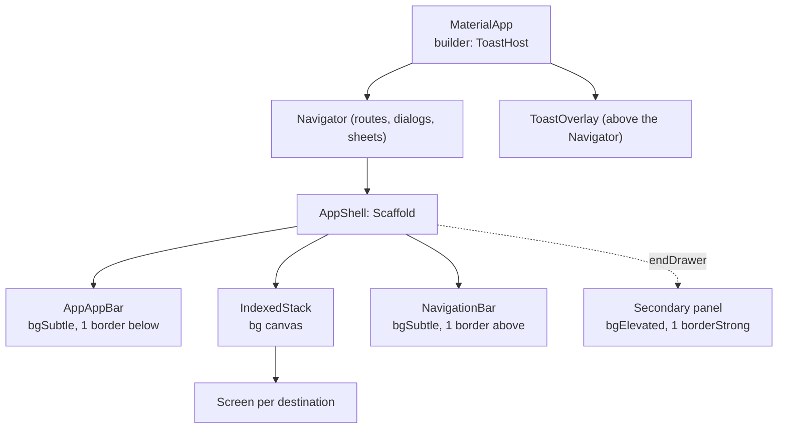
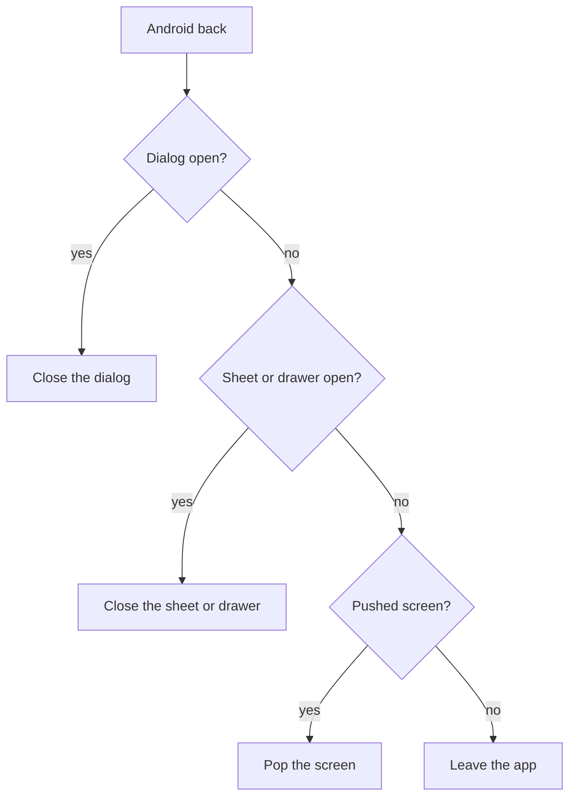
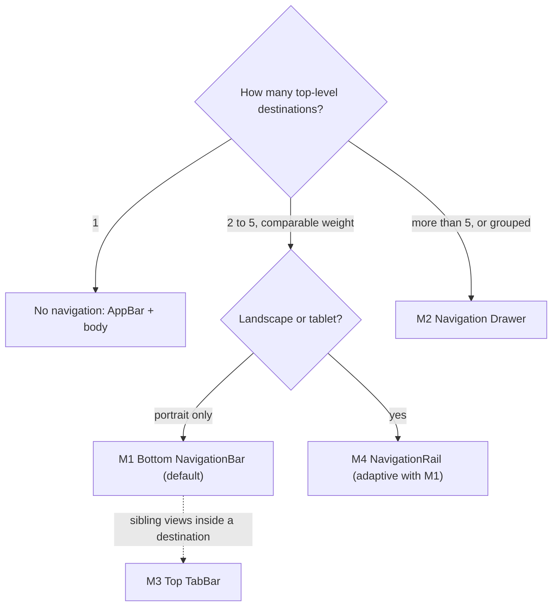

# Layout System - v3.2 (Flutter / Android)

> The **structural defaults** (global structure, AppShell, AppBar, NavigationBar, content area, secondary panel, recurring components, gestures) are shared by **both** design-system modes. The **skin/feedback** parts that reference framework tokens or the custom toast system (notably §6 Toast) apply in `framework` mode only. In `native` mode (`rules/native-design.md`), feedback uses native `SnackBar`/`MaterialBanner` and Material default shapes; the §12 pattern catalog is structural and shared by both modes.
> Companion layout reference, not a constraint. This file provides: (1) a **proposed default
> composition** and a **catalog of alternative composition patterns** (§12) that Claude co-designs
> from in Phase 3, the user amending or replacing freely;
> (2) the **feedback spec** (toasts, dialogs) serving the error contract; (3) **defaults and
> technical recommendations** (dimensions, behaviors), never a composition restriction.
> The retained composition is the one validated in `docs/specs/03-surfaces.md` and locked in
> `docs/specs/04-architect.md`.
> Built on `design-system.md v2.1 (Flutter)`. The two files are inseparable.
> Validated mobile transposition of the desktop layout: AppBar ↔ topbar, NavigationBar ↔ tabs, custom overlay toasts kept, status bar removed.
> Stack: Android (minSdkVersion 24), Flutter stable, Dart 3, Riverpod 3 with code generation, strict layers `data` / `application` / `presentation`.

## Changelog

| Version | Date       | Main change |
| ------- | ---------- | ----------- |
| v3.2    | 2026-10-25 | design-system v2.1 alignment: **surface ladder** applied to every zone (AppBar, TabBar, NavigationBar, NavigationRail on `bgSubtle`; dialog, drawer, sheet on `bgElevated`; canvas on `bg`) · default hex refreshed · pointer hover step transparent → `borderStrong` · control edge `borderStrong` · selected list, tree and drawer items carry a 2 `primary` leading bar, the NavigationBar and NavigationRail indicator a 1 `primary` stroke · **no gesture-only action**: every swipe has a visible alternative · toasts: top offset follows the bars actually mounted (`shellInsetsProvider`), danger toast is a `Semantics` live region · dialog opens with focus on Cancel · back handling by `PopScope.onPopInvokedWithResult` · Riverpod 3 controllers (`ToastController`, `ActiveDestination`, `ThemeModeController`) · strings localized at the call site, never in a controller · a device validation list (§13) |
| v3.1    | 2026-07-16 | design-system v2.0 alignment: TabBar indicator = signature underline · Lucide icon names · no toast entry/exit animations (motion policy) · radius 5 on sheets/dialogs · floating layers (drawer, sheet, dialog) marked by `borderStrong` · durations 160/240ms `easeOut` |
| v3.0    | 2026-07-14 | Composition pattern catalog (§12): Drawer, top TabBar, NavigationRail alternatives; Phase 3 becomes a guided co-design flow |
| v2.0    | 2026-07-13 | Non-binding composition: mandatory AppShell becomes the proposed default; destination cap becomes a technical recommendation |
| v1.1    | 2026-06-14 | coherent dark toasts · tree chevron `textSubtle` (WCAG) · overlay layering reference |
| v1.0    | initial    | Mobile transposition: AppBar, NavigationBar, overlay toasts, components |

Every generated application references the active version in its `README.md`.

## Deviations from v3.1

| Area | v3.1 | v3.2 | Reason |
| ---- | ---- | ---- | ------ |
| AppBar, TabBar, NavigationBar, NavigationRail fill | `bg` | `bgSubtle` | chrome sits one level above the canvas |
| Dialog fill | `bg` | `bgElevated` | floating layer, level N3 |
| Hover on neutral items (pointer) | transparent → `border` | transparent → `borderStrong` | 3:1 hover rule |
| Selected item | `primaryBg` and `primary` content | plus a 2 `primary` leading bar (list, tree, drawer item); NavigationBar and NavigationRail indicator get a 1 `primary` stroke | WCAG 1.4.1 |
| Navigation drawer item | active = `primaryBg` | plus the 2 leading bar | idem |
| Swipe actions | swipe to delete, optional | swipe stays optional but a visible alternative (per-item menu button) is mandatory | WCAG 2.5.1: no path-based gesture as the only way |
| Dialog initial focus | unspecified | Cancel (`autofocus`) | the safe default, mirrors the Python and Electron modals |
| Toast top offset | `spacing4` below the AppBar | status bar inset + bars actually mounted (AppBar, TabBar) + `spacing4`, from `shellInsetsProvider` | holds in M1, M2 and M3 |
| Danger toast | persistent, close button | plus `Semantics(liveRegion: true)` | TalkBack announces it |
| Back handling | `PopScope.onPopInvoked` | `PopScope.onPopInvokedWithResult` | `onPopInvoked` is deprecated |
| Overlay colors | `text` 40 % opacity | unchanged, written `text.withValues(alpha: opacityOverlay)` | `withOpacity` is deprecated |
| Strings | unspecified | localized at the call site (screen), passed to controllers as arguments | layers import downward only |

---

## 1. GLOBAL STRUCTURE

Proposed default composition: submitted in Phase 3, amendable or replaceable by the user.

```
┌─────────────────────────────────────┐
│           APPBAR (56dp)             │
│  [ Title ]            [ Theme ]     │
├─────────────────────────────────────┤
│                                     │
│           MAIN CONTENT              │
│         (scrollable area)           │
│                                     │
├─────────────────────────────────────┤
│       NAVIGATIONBAR (80dp)          │
│   [ Dest 1 ] [ Dest 2 ] [ Dest 3 ]  │
└─────────────────────────────────────┘
```

Proposed default skeleton (`AppShell`, `lib/presentation/screens/app_shell.dart`):

```
MaterialApp (builder: ToastHost)
└── Scaffold
    ├── appBar: AppAppBar            # current screen title + actions + theme toggle
    ├── body: IndexedStack           # one screen per destination, state preserved
    └── bottomNavigationBar: NavigationBar (M3) - if ≥ 2 destinations
Root overlay: ToastOverlay           # stacked toasts, above every modal route
```



- 1 destination only → no NavigationBar (AppBar + body only).
- 2 to 5 destinations → NavigationBar. Technical recommendation: beyond 5, the Material `NavigationBar` degrades (labels truncate, touch targets shrink); the suggested pattern is 4 destinations + "More" (list screen), not an imposed rule.

**Toast** (overlaid, top of screen):

```
┌─────────────────────────────────────┐
│           APPBAR                    │
│  ┌───────────────────────────────┐  │
│  │ [icon] Message            [×] │  │
│  └───────────────────────────────┘  │
│           MAIN CONTENT              │
├─────────────────────────────────────┤
│         NAVIGATIONBAR               │
└─────────────────────────────────────┘
```

**Secondary panel** (optional, chosen in Phase 3): `endDrawer` (right side) or modal `BottomSheet`.

### Shell skeleton (Riverpod 3)

```dart
// lib/presentation/screens/app_shell.dart
class AppShell extends ConsumerWidget {
  const AppShell({super.key});

  @override
  Widget build(BuildContext context, WidgetRef ref) {
    final index = ref.watch(activeDestinationProvider);
    final destinations = AppDestinations.of(context);          // localized labels, one list
    return Scaffold(
      appBar: AppAppBar(title: destinations[index].label),
      body: IndexedStack(index: index, children: [for (final d in destinations) d.screen]),
      bottomNavigationBar: DecoratedBox(
        decoration: BoxDecoration(border: Border(top: BorderSide(color: context.colors.border))), // token: border
        child: NavigationBar(
          selectedIndex: index,
          onDestinationSelected: ref.read(activeDestinationProvider.notifier).select,
          destinations: [
            for (final d in destinations)
              NavigationDestination(icon: Icon(d.icon), label: d.label, tooltip: d.label),
          ],
        ),
      ),
    );
  }
}
```

```dart
// lib/application/active_destination.dart
@Riverpod(keepAlive: true)
class ActiveDestination extends _$ActiveDestination {
  @override
  int build() => ref.watch(preferencesRepositoryProvider).lastDestination;   // §10

  Future<void> select(int index) async {
    state = index;
    await ref.read(preferencesRepositoryProvider).saveLastDestination(index);
  }
}
```

---

## 2. APPLICATION

Default values, customizable in Phase 3.

| Token / option        | Default                                                     |
| --------------------- | ------------------------------------------------------------ |
| orientation           | portrait only (default), landscape on Phase 1 request        |
| theme on launch       | follows the OS theme (`ThemeMode.system`) if no preference    |
| OS default theme      | light                                                         |
| Android system bar    | current theme `bgSubtle` color (`SystemUiOverlayStyle`), icon brightness from the theme; edge-to-edge insets respected on Android 15 and later |
| Android back button   | handled by `PopScope` (`onPopInvokedWithResult`): closes sheet/dialog/drawer before exiting |
| splash                | native Android, light `bg` background, centered logo (flutter_native_splash if validated in Phase 1) |
| language              | French default, English second, `flutter_localizations` + gen-l10n (ARB); every visible string through `AppLocalizations` |

---

## 3. APPBAR

| Token              | Default                 |
| ------------------ | ----------------------- |
| height             | `appbarHeight` = 56     |
| light/dark bg      | `bgSubtle` (chrome, N1) |
| bottom border      | 1 `border` (no shadow: `elevation: 0`, `shape: Border(bottom: ...)`) |
| horizontal padding | `spacing4` = 16         |

### Zones (left → right)

```
[ Current screen title ]   ···   [ Contextual actions ]  [ Theme ]
```

| Zone   | Content                                                        |
| ------ | --------------------------------------------------------------- |
| Left   | Active screen title: `weightSemibold` `fontBase`, `text`. No logo (mobile). |
| Right  | 0-2 contextual actions (`iconLg` icons) + theme selector       |

### Theme selector

- Icon only (Lucide `sun` / `moon`), `iconLg` = 24, touch zone `touchTarget` = 48.
- Mandatory `tooltip` (it is also the semantic label): "Passer en mode sombre" / "Passer en mode clair".
- Instant toggle: `MaterialApp` `themeMode` (`ThemeModeController`), persisted via `shared_preferences`.

---

## 4. NAVIGATIONBAR (Material 3)

| Token               | Default                         |
| ------------------- | ------------------------------- |
| height              | `navbarHeight` = 80             |
| bg                  | `bgSubtle` (chrome, N1)         |
| top border          | 1 `border`, `elevation: 0` (a `DecoratedBox` around the bar: `NavigationBar` has no border parameter) |
| destinations        | 2 to 5 recommended (NavigationBar ergonomics) |
| active indicator    | `primaryBg` fill **and** 1 `primary` stroke, radius 5 (non-color cue); `primary` icon + label |
| inactive destination| `textSubtle` icon + label       |
| label               | `weightMedium` `fontXs`, always visible, wraps at large text sizes, never ellipsized |
| icons               | `iconLg` = 24, Lucide (`lucide_icons_flutter`) |

- State-based navigation (`IndexedStack` + `activeDestination` provider): each screen's state is preserved on tab change.
- Splash/ripple: disabled (`NoSplash`, `design-system.md §8`), `bgMuted` pressed highlight.
- Each destination has a `tooltip` equal to its label.

---

## 5. MAIN CONTENT AREA

| Token             | Default                                |
| ----------------- | ---------------------------------------- |
| bg                | `bg` (canvas, N0)                        |
| inner padding     | `spacing4` = 16 (mobile, full width)     |
| scroll            | vertical: `ListView` / `SingleChildScrollView` |
| bottom inset      | keyboard and gesture-navigation insets via `SafeArea` and `MediaQuery.viewInsets` |

### Section header

```
[ Section title ]
[ Subtitle / short description ]
```

- Title: `weightBold` `font2xl` (24), `text` (`headlineMedium`).
- Subtitle: `weightNormal` `fontSm` (14), `textSubtle`.
- Bottom margin: `spacing6` = 24 before the content.
- If the screen title is already in the AppBar: no duplicate; the section header is reserved for sub-sections.

---

## 6. TOAST

Fully replaces `SnackBar` and inline banner. Neither is used in the applications.
Component: `presentation/widgets/toast_overlay.dart` + Riverpod controller `toastControllerProvider` (queue).

| Token                  | Value                                               |
| ---------------------- | --------------------------------------------------- |
| position               | Top of screen, below the system area (SafeArea) and the bars actually mounted, overlaid |
| width                  | screen width − 2 × `spacing4`                       |
| top offset             | status bar inset + `appbarHeight` (+ `tabbarHeight` when a top TabBar is mounted) + `spacing4`, read from `shellInsetsProvider` |
| spacing between toasts | `spacing2` = 8                                      |
| stacking               | Vertical, queue, no overlap                         |
| enter / exit           | Instant: no entry/exit animation, the stack reflows without animation (motion policy, `design-system.md §6`) |
| gesture                | Swipe up = dismiss (dismissible types); the close button is the visible alternative |

### Display durations

| Type      | Duration   | Manual dismiss      |
| --------- | ---------- | ------------------- |
| `success` | 4s         | No                  |
| `info`    | 4s         | No                  |
| `warning` | 6s         | Yes (×)             |
| `danger`  | persistent | Yes (×) mandatory   |

### Toast anatomy

```
┌────────────────────────────────────┐
│ [icon]  Main message           [×] │
│         Optional description       │
└────────────────────────────────────┘
```

| Token              | Value                                       |
| ------------------ | -------------------------------------------- |
| padding            | `spacing3` vertical, `spacing4` horizontal   |
| left border        | 4 semantic color (`borderWidthAccent`)       |
| bg                 | semantic bg (`*50`)                          |
| message font       | `weightMedium` `fontSm` (14), `text`         |
| description font   | `weightNormal` `fontXs` (12), `textSubtle`   |
| icon               | `iconMd` = 20                                |
| radius             | `radius` = 5                                 |

| Type      | Bg          | Border       | Icon (Lucide)          |
| --------- | ----------- | ------------ | ---------------------- |
| `success` | `success50` | `success600` | `circleCheck`          |
| `warning` | `warning50` | `warning600` | `triangleAlert`        |
| `danger`  | `danger50`  | `danger600`  | `circleX`              |
| `info`    | `info50`    | `info600`    | `info`                 |

Dark mode: the toast uses one coherent palette per theme, all from the active `AppColors` constant: bg `*50` (deep tint in dark, see `design-system.md §2`), text `text`, left border + icon `*600`. No mixing of light bg with dark accent. Icons use the matching `icon*` token (`iconSuccess`/`iconWarning`/`iconDanger`/`iconInfo`).

Layering: the `ToastOverlay` is mounted at the root (above modal routes) so a persistent `danger` toast stays visible over a dialog/sheet (`design-system.md §13`).

Accessibility: a `danger` toast is wrapped in `Semantics(liveRegion: true)`; every toast has a close button reachable by TalkBack when it is dismissible; the message is never conveyed by color alone (icon shape + word).

### Controller (Riverpod 3)

```dart
// lib/application/toast_controller.dart
enum ToastTone { success, info, warning, danger }

@immutable
class ToastMessage {
  const ToastMessage({required this.id, required this.tone, required this.message, this.description});
  final int id;
  final ToastTone tone;
  final String message;        // already localized by the caller (presentation layer)
  final String? description;
}

@Riverpod(keepAlive: true)
class ToastController extends _$ToastController {
  int _next = 0;
  final Map<int, Timer> _timers = {};

  @override
  List<ToastMessage> build() {
    ref.onDispose(() {
      for (final timer in _timers.values) {
        timer.cancel();
      }
    });
    return const [];
  }

  /// Queue a toast; success and info vanish after 4s, warning after 6s, danger stays.
  int push(ToastTone tone, String message, {String? description}) {
    final id = _next++;
    state = [...state, ToastMessage(id: id, tone: tone, message: message, description: description)];
    final seconds = switch (tone) {
      ToastTone.success || ToastTone.info => 4,
      ToastTone.warning => 6,
      ToastTone.danger => null,
    };
    if (seconds != null) {
      _timers[id] = Timer(Duration(seconds: seconds), () => dismiss(id));
    }
    return id;
  }

  void dismiss(int id) {
    _timers.remove(id)?.cancel();
    state = [for (final t in state) if (t.id != id) t];
  }
}
```

```dart
// A screen localizes, the controller only queues
final l10n = AppLocalizations.of(context);
ref.read(toastControllerProvider.notifier).push(ToastTone.success, l10n.clientSaved);
```

### Shell insets

The `ToastHost` sits above the `Navigator`, so it cannot measure the AppBar. The shell publishes the height of the bars actually mounted; the toast stack and any overlay that must clear the bars read it.

```dart
// lib/application/shell_insets.dart
@Riverpod(keepAlive: true)
class ShellInsets extends _$ShellInsets {
  @override
  double build() => AppTokens.appbarHeight;          // AppBar only (pattern M1)

  /// Called by a screen that mounts a top TabBar (pattern M3), and reset on dispose.
  void set(double top) => state = top;
}

// ToastOverlay: top = MediaQuery.paddingOf(context).top + ref.watch(shellInsetsProvider) + AppTokens.spacing4
```

---

## 7. SECONDARY PANEL

Chosen in Phase 3: `endDrawer` or `BottomSheet`. Opened by explicit action only. Never automatically. Default values below.

### endDrawer (right side)

| Token          | Default                                     |
| -------------- | --------------------------------------------- |
| width          | 85 % screen, max `drawerMaxWidth` = 360       |
| animation      | slide from the right, `transitionSlow` = 240ms `easeOut` |
| bg             | `bgElevated` (floating layer, N3)             |
| left border    | 1 `borderStrong` (`design-system.md §5`)      |
| padding        | `spacing6` = 24                               |
| overlay bg     | `text.withValues(alpha: opacityOverlay)` (`scrimColor`) |

- Close: tap overlay, Android back button, or × button in the drawer.
- Header: `weightSemibold` `fontLg` (18) title + × button aligned right (`tooltip` "Fermer").
- Content vertically scrollable on overflow.
- Focus: the panel is a route-like layer; TalkBack reads the drawer only while it is open, and focus returns to the opener on close.

### Modal BottomSheet

| Token        | Default                                 |
| ------------ | ---------------------------------------- |
| width        | full width                               |
| height       | content, max 90 % screen                 |
| animation    | slide from the bottom, `transitionSlow` = 240ms `easeOut` |
| bg           | `bgElevated`, `radius` 5 on the top corners |
| top border   | 1 `borderStrong` (`design-system.md §5`) |
| padding      | `spacing6` = 24 + bottom SafeArea        |
| overlay bg   | `text.withValues(alpha: opacityOverlay)` |

- Close: tap overlay, back button, swipe down, or × button (the button is the visible alternative to the swipe).
- Header identical to the drawer. Scrollable content (`DraggableScrollableSheet` if long).

---

## 8. RECURRING COMPONENTS

### Data list (mobile counterpart of the desktop table)

On mobile, a data table becomes a vertical list of structured items (`ListView.separated`).

- Item: full width, vertical padding `spacing2` (8) + horizontal `spacing4`, min height `touchTarget`.
- Item structure: main line `weightMedium` `fontSm` `text` + secondary line `fontXs` `textSubtle` + value/action on the right. Figures use `FontFeature.tabularFigures()` and are right-aligned.
- Sorting: a mobile list has no clickable column headers, so expose a **sort control** in the section header: a dropdown or segmented control picking the sort field, plus a toggle for ascending / descending. The list reorders in place; the control shows the active field and direction and exposes it to TalkBack. (If a genuine `DataTable` is used instead of the list, sort via `DataColumn.onSort` with its ascending flag: same ascending/descending behavior.)
- Separator: 1 `borderSubtle`.
- Group header (if grouping): `bgSubtle` bg, `weightSemibold` `fontSm`, `textSubtle`, bottom border 2 `borderStrong`.
- Selected item: `primaryBg` bg, `primary` content **and the 2 `primary` leading bar** (`design-system.md §8`, reserved at rest as a transparent border so nothing shifts). `Semantics(selected: true)`.
- Pressed: `bgMuted`. Pointer hover (mouse, ChromeOS): transparent 1 border → `borderStrong`.
- Row alternation: disabled (uniform surfaces, depth by stroke).
- **Long lists: native lazy loading (`ListView.builder`) + pagination recommended in batches of ~50 on scroll** (replaces desktop button pagination). Loading indicator at the list footer; an accessible status text ("Chargement…") while it runs.
- Per-item actions: a visible **overflow button** (`LucideIcons.ellipsisVertical`, `tooltip` naming the row: "Actions pour Dupont") opening a menu on `bgElevated`. Swipe (`Dismissible`) for deletion with confirmation is an optional shortcut and never the only path. Chosen in Phase 3.

### Input form

- Labels above the fields, `weightMedium` `fontSm`, `text`.
- Fields: full width, dynamic height (vertical contentPadding `spacing2`), 1 `borderStrong` border (control edge), focus 2 `primary`, centralized in `inputDecorationTheme`.
- Spacing between fields: `spacing4` = 16.
- Field in error: 2 `danger600` border + `danger600` message below the field, `fontXs`, via `errorText` (mirrored in the semantics of the field).
- Form actions: aligned right: Cancel (secondary) + Confirm (primary); on a full input screen: Confirm at the bottom, full width.
- Keyboard: consistent `textInputAction` (next/done), adapted `keyboardType`, `autofillHints` where they apply, automatic scroll to the focused field.

### Tree view

- Indentation per level: `spacing4` = 16.
- Expand/collapse icon: Lucide `chevronRight` / `chevronDown`, `iconSm` = 16, `textSubtle` (interactive control: `textMuted` fails AA contrast).
- Item: vertical padding `spacing1` (4), min touch height `touchTarget`.
- Selected item: `primaryBg` bg + 2 `primary` leading bar. `Semantics(expanded:)` on expandable nodes.

### Charts / Visualization

- Transparent background (inherits the content).
- Palette: `chartPrimary`, `chartSuccess`, `chartWarning`, `chartDanger`, `chartInfo`.
- Hue alone never separates two series: add a marker shape, a dash pattern or a direct label.
- Legend: `weightNormal` `fontSm`, `textSubtle`. No shadow.
- Library (fl_chart…): to validate in Phase 1 (none by default).

### Rich editor - flutter_quill (if enabled in Phase 1)

- `QuillSimpleToolbar`: `bgSubtle` bg, bottom border 1 `border`, `iconMd` `iconDefault` icons, active button `primaryBg` bg `primary` icon.
- `QuillEditor`: `spacing4` padding, text styles mapped to the typographic tokens.
- Content persisted as Delta JSON (SQLite TEXT column, `sqflite`, parameterized SQL only).
- Toolbar limited to the controls required by the validated features, not the full toolbar by default.

### Dialog (modal)

```
┌─────────────────────────────────────┐
│  Dialog title                   [×] │
├─────────────────────────────────────┤
│  Content (form, text…)              │
├─────────────────────────────────────┤
│              [ Cancel ] [ Confirm ] │
└─────────────────────────────────────┘
```

`AppDialog` component (`showDialog` + custom widget), never a raw `AlertDialog`.

| Token        | Default                          |
| ------------ | -------------------------------- |
| width        | screen width − 2 × `spacing6`    |
| bg           | `bgElevated`, `radius` 5, `elevation` 0 |
| border       | 1 `borderStrong` (floating layer, `design-system.md §5`) |
| padding      | `spacing6` = 24                  |
| overlay bg   | `text.withValues(alpha: opacityOverlay)` (`barrierColor`) |

- Opened by explicit action only.
- Close: ×, Cancel, Android back button, tap overlay.
- Focus: on open, focus lands on Cancel (`autofocus: true`), the safe default; Tab (external keyboard) cycles Cancel, Confirm, ×; focus returns to the opener on close.
- Header: `weightSemibold` `fontLg` title + × on the right, bottom border 1 `borderSubtle`.
- Footer: Cancel (secondary) + Confirm (primary) on the right, top border 1 `borderSubtle`.
- Destructive confirmations: this dialog, Confirm button in danger variant.
- Semantics: the dialog is a named route (`Semantics(scopesRoute: true, namesRoute: true)` through `AlertDialog`-like wrapping, label = title).

```dart
// lib/presentation/widgets/app_dialog.dart
Future<bool> showConfirmDialog(
  BuildContext context, {
  required String title,
  required String message,
  required String confirmLabel,
  required String cancelLabel,
  bool destructive = false,
}) async {
  final colors = context.colors;
  final result = await showDialog<bool>(
    context: context,
    useRootNavigator: true,
    barrierColor: colors.text.withValues(alpha: AppTokens.opacityOverlay),   // token: text @ opacityOverlay
    builder: (_) => AppDialog(
      title: title,
      body: Text(message),
      actions: [
        AppButton.secondary(cancelLabel, autofocus: true, onPressed: () => Navigator.of(context, rootNavigator: true).pop(false)),
        destructive
            ? AppButton.danger(confirmLabel, onPressed: () => Navigator.of(context, rootNavigator: true).pop(true))
            : AppButton.primary(confirmLabel, onPressed: () => Navigator.of(context, rootNavigator: true).pop(true)),
      ],
    ),
  );
  return result ?? false;
}
```

---

## 9. GESTURES & SYSTEM NAVIGATION

Default behaviors, customizable in Phase 3.

| Gesture / button        | Action                                                    |
| ----------------------- | ---------------------------------------------------------- |
| Android back            | Closes in order: dialog → sheet/drawer → pushed screen → app (`PopScope`) |
| Swipe up on toast       | Dismiss (dismissible types); the × button is the alternative |
| Swipe on list item      | Deletion with confirmation (if enabled in Phase 3); the overflow button offers the same action |
| Tap navbar destination  | Change screen, state preserved                             |
| Pull-to-refresh         | `RefreshIndicator` on data lists (`primary` color); a refresh action is also reachable from the AppBar or the section header |
| External keyboard / TV  | Tab and arrows move focus (inside ring, `design-system.md §7`), Enter and Space activate, Escape closes the top dialog, sheet or drawer |



> Back handling: dialogs, sheets and drawers are routes or Scaffold layers that pop themselves; `PopScope` only intercepts the root screen (`canPop: false` while an unsaved form is open, then `onPopInvokedWithResult` asks for confirmation). Validate the Android predictive-back animation on a device (Android 14 and later, `enableOnBackInvokedCallback`).

---

## 10. PERSISTED PREFERENCES

`shared_preferences`: accessed only through `data/repositories/preferences_repository.dart`, exposed by a Riverpod provider. The `SharedPreferences` instance is created once in `main()` and injected with `sharedPreferencesProvider.overrideWithValue` (`design-system.md §11`).

| Preference            | Default value     |
| --------------------- | ----------------- |
| theme                 | OS system         |
| last destination      | first             |
| locale (if i18n)      | fr                |

```dart
// lib/data/repositories/preferences_repository.dart
@Riverpod(keepAlive: true)
SharedPreferences sharedPreferences(Ref ref) => throw UnimplementedError('Override in main()');

@Riverpod(keepAlive: true)
PreferencesRepository preferencesRepository(Ref ref) =>
    PreferencesRepository(ref.watch(sharedPreferencesProvider));

/// Typed access to the persisted preferences.
class PreferencesRepository {
  PreferencesRepository(this._prefs);
  final SharedPreferences _prefs;

  ThemeMode get themeMode => switch (_prefs.getString('theme')) {
        'light' => ThemeMode.light,
        'dark' => ThemeMode.dark,
        _ => ThemeMode.system,
      };
  Future<void> saveThemeMode(ThemeMode mode) => _prefs.setString('theme', mode.name);

  int get lastDestination => _prefs.getInt('last_destination') ?? 0;
  Future<void> saveLastDestination(int index) => _prefs.setInt('last_destination', index);
}
```

---

## 11. DESIGN SYSTEM CROSS-REFERENCE

This file does not redefine tokens: it consumes them. Every visual value is traced to `design-system.md v2.1 (Flutter)`.

| Need                       | Token                                        |
| -------------------------- | -------------------------------------------- |
| Main background (canvas)   | `bg`                                         |
| Chrome (AppBar, TabBar, NavigationBar, NavigationRail) | `bgSubtle`        |
| Panels and cards           | `bgPanel`                                    |
| Drawer / sheet / dialog background | `bgElevated`                         |
| Pressed highlight          | `bgMuted`                                    |
| Primary text               | `text`                                       |
| Secondary text             | `textSubtle`                                 |
| Borders                    | `border` / `borderSubtle` / `borderStrong`   |
| Control edge               | `borderStrong`                               |
| Active / selection color   | `primary` / `primaryBg` + 2 leading bar or 1 indicator stroke |
| Danger button fill         | `dangerFill`                                 |
| Minimum touch surface      | `touchTarget` = 48                           |
| Easing                     | `easeOut` (`Curves.easeOutCubic`)            |
| Panel transitions          | `transitionSlow` = 240ms                     |
| State transitions          | `transitionDefault` = 160ms                  |
| Shape                      | `radius` = 5 (nested: 3)                     |
| Shadows                    | `elevation` = 0, floating layers marked by `borderStrong` |
| Line-height                | `leadingTight` 1.25 / `leadingNormal` 1.5    |
| Overlay scrim opacity      | `opacityOverlay` 0.4 (`text` color)          |
| Disabled opacity           | `opacityDisabled` 0.4                        |
| Overlay order              | layering (`design-system.md §13`)            |

---

## 12. COMPOSITION PATTERNS

Catalog of alternative composition patterns for the Phase 3 co-design flow. The default composition (§1-§10) is pattern **M1**. Each pattern below is a starting point the user may amend or replace; dimensions are defaults. The retained composition is recorded in `docs/specs/03-surfaces.md` and locked in `docs/specs/04-architect.md`. The patterns are **structural**: they apply in both design-system modes (`framework` and `native`). The feedback spec (§6 toasts, §8 dialogs) applies to every pattern; in `native` mode read it as `SnackBar`/`MaterialBanner`/`AlertDialog` (`rules/native-design.md §6`).



### M1 - Bottom NavigationBar (default)

Material 3 bottom navigation: the composition proposed by default in Phase 3.

**Structure**: see §1 (AppShell, toast overlay, secondary panel) and §4 (NavigationBar tokens, destinations, state-based navigation). Not repeated here.

| Element        | Default                                                     |
| -------------- | ----------------------------------------------------------- |
| AppBar         | `appbarHeight` = 56, `bgSubtle`: §3                          |
| NavigationBar  | `navbarHeight` = 80, `bgSubtle`, 2 to 5 destinations recommended: §4 |
| body           | `IndexedStack`: one screen per destination, state preserved  |

**When to recommend**: 2-5 top-level destinations of comparable weight, reachable in one tap, flat hierarchy.

**Implementation notes**: `AppShell` = `Scaffold` + `appBar` + `body: IndexedStack` + `bottomNavigationBar: NavigationBar` (§1). A single destination → no NavigationBar. Beyond 5, the technical recommendation of §1 applies (4 destinations + a "More" screen).

**Interactions**: toasts (§6), secondary panel (§7), dialogs (§8), and gestures (§9) unchanged. A top `TabBar` (M3) may be added inside one destination.

### M2 - Navigation Drawer

Sliding side menu opened from a hamburger in the AppBar: for many sections or a rich secondary navigation.

**Structure**

```
┌─────────────────────────────────────┐
│ [≡]  APPBAR (56dp)      [ Theme ]   │
├─────────────────────────────────────┤
│                                     │
│           MAIN CONTENT              │
│         (scrollable area)           │
│                                     │
│                                     │
└─────────────────────────────────────┘
   [≡] opens →  ┌──────────────────┐
                │ DRAWER (max 360) │
                │ [ico] Section 1  │
                │ [ico] Section 2  │
                │ …                │
                └──────────────────┘
```

| Element           | Default                                                    |
| ----------------- | ----------------------------------------------------------- |
| width             | 85 % screen, max `drawerMaxWidth` = 360 (same as the §7 panel) |
| bg                | `bgElevated`, 1 `borderStrong` on the right edge            |
| item              | icon `iconLg` (24) + label `weightMedium` `fontSm`, min height `touchTarget` |
| item label        | word-wraps within the drawer width (`Text(softWrap: true, overflow: TextOverflow.visible)`), never ellipsized, so long labels stay fully visible |
| active item       | `primaryBg` background, `primary` icon + label, **2 `primary` leading bar** |
| inactive item     | `textSubtle` icon + label                                   |
| pointer hover     | transparent 1 border → `borderStrong`                       |
| section header    | `weightSemibold` `fontSm`, `textSubtle`: for grouped items  |
| overlay bg        | `text.withValues(alpha: opacityOverlay)` (`scrimColor`)     |
| animation         | slide from the left, `transitionSlow`                       |

**When to recommend**: more than 5 sections; grouped or secondary navigation (settings, about, account) that does not deserve a bottom destination; long labels.

**Implementation notes**: `Scaffold(drawer: NavigationDrawer(...))`: the leading hamburger is added automatically (give it a `tooltip`, "Ouvrir le menu"). **Not the same thing as the `endDrawer` of §7**: §7 is the optional *secondary panel* (filters, details) on the right; M2 is the *navigation* drawer on the left. Both can coexist (`drawer:` + `endDrawer:`). Screens stay in an `IndexedStack` driven by the `activeDestination` provider: selecting an item sets the index and closes the drawer. Android back closes the drawer first (§9).

**Interactions**: toasts (§6), secondary panel (§7), dialogs (§8) unchanged. M2 can carry a bottom NavigationBar (M1) for the 3-4 main destinations while the drawer holds the rest.

### M3 - Top TabBar

`TabBar` under the AppBar: for sibling views inside one section.

**Structure**

```
┌─────────────────────────────────────┐
│           APPBAR (56dp)             │
├─────────────────────────────────────┤
│  [ Tab 1 ] [ Tab 2 ] [ Tab 3 ]      │  TABBAR (48dp)
├─────────────────────────────────────┤
│           MAIN CONTENT              │
│         (TabBarView)                │
├─────────────────────────────────────┤
│       NAVIGATIONBAR (optional)      │
└─────────────────────────────────────┘
```

| Element          | Default                                              |
| ---------------- | ------------------------------------------------------ |
| height           | `tabbarHeight` = 48                                    |
| bg               | `bgSubtle` (shared with the AppBar), 1 `border` bottom border, `elevation: 0` |
| active tab       | `primary` label + the **signature underline**: 2 `primary` `UnderlineTabIndicator` that slides natively between tabs (`design-system.md §8`) |
| inactive tab     | `textSubtle` label                                     |
| label            | `weightMedium` `fontSm` (14)                           |
| scrollable       | `isScrollable: true` beyond 3-4 tabs (avoids truncation) |
| swipe            | horizontal swipe between tabs (`TabBarView` default); tapping a tab is the visible alternative |
| pointer hover    | transparent 1 border → `borderStrong`                  |

**When to recommend**: sibling views of one section (All / Active / Archived), compared or switched often; a filter dimension rather than a navigation dimension.

**Implementation notes**: `TabBar` in the AppBar's `bottom:` + `TabBarView` in the body, driven by a `TabController` (`DefaultTabController` or a `TickerProvider` in the screen). Styling centralized in `tabBarTheme` (`app_theme.dart`), never per-screen (`@rules/theme.md`). With reduced motion (`MediaQuery.disableAnimationsOf`), create the controller with `animationDuration: Duration.zero`. The screen publishes the extra 48 dp to `shellInsetsProvider` so toasts sit below the TabBar. **Combines with M1**: the tabs live *inside* one destination, they do not replace the destinations.

**Interactions**: toasts (§6) still overlay at the top of the screen, below the AppBar and the TabBar. Secondary panel (§7), dialogs (§8), and gestures (§9) unchanged; the swipe-between-tabs gesture coexists with the swipe-to-delete of a list item (§8): confirm both are wanted.

### M4 - NavigationRail

Vertical Material 3 rail on the left edge: the landscape/tablet counterpart of M1.

**Structure**

```
┌──────┬──────────────────────────────┐
│ RAIL │        APPBAR (56dp)         │
│(80dp)├──────────────────────────────┤
│[ico] │                              │
│[ico] │        MAIN CONTENT          │
│[ico] │      (scrollable area)       │
│      │                              │
└──────┴──────────────────────────────┘
```

| Element           | Default                                                   |
| ----------------- | ----------------------------------------------------------- |
| width             | `railWidth` = 80 (icons + labels), 72 icons only            |
| bg                | `bgSubtle`, 1 `border` right border, `elevation: 0`         |
| destination       | icon `iconLg` (24) + label `weightMedium` `fontXs`          |
| active indicator  | `primaryBg` fill + 1 `primary` stroke, `primary` icon + label |
| inactive          | `textSubtle` icon + label                                   |
| pointer hover     | transparent 1 border → `borderStrong`                       |
| label behavior    | `NavigationRailLabelType.all` (labels always visible)       |
| label wrapping    | destination label word-wraps within the 80 rail width (`NavigationRailDestination(label: Text(..., softWrap: true, overflow: TextOverflow.visible, textAlign: TextAlign.center))`), never truncated, so it stays fully visible |
| leading           | optional: main action (FAB-like) at the top of the rail     |

**When to recommend**: landscape orientation or tablet (landscape allowed in Phase 1); a wide screen where a bottom bar wastes vertical space. Same 2-5 destination range as M1.

**Implementation notes**: `Row(children: [NavigationRail(...), Expanded(child: body)])` inside the `Scaffold` body. **Adaptive variant of M1**: the same `activeDestination` provider drives both; switch on `MediaQuery.orientationOf(context)` / width in `AppShell` and render `NavigationRail` in landscape, `NavigationBar` in portrait, with a single destinations list. The `IndexedStack` and the screens are unchanged.

**Interactions**: toasts (§6), secondary panel (§7), dialogs (§8) unchanged. Portrait-only apps (§2 default orientation) rarely need M4: check the Phase 1 orientation choice before recommending it.

---

## 13. DEVICE VALIDATION

No Flutter SDK was reachable while this file was written, so the Dart snippets and the dimensions above were not compiled or run. Before shipping a generated application:

- `flutter analyze` clean and `dart run build_runner build` for `@riverpod` providers.
- AppBar 56, TabBar 48, NavigationBar 80 and the 48 dp tap areas on a real device (Layout Inspector).
- Toast offset under the AppBar (and TabBar), with the keyboard open and in landscape.
- TalkBack: danger toast announcement, focus order under a dialog, drawer and sheet, focus return to the opener.
- Text scale 1.0, 1.3, 2.0 on every pattern in use (wrapping labels in M2 and M4, NavigationBar labels).
- Android predictive back, reduced motion ("Remove animations"), edge-to-edge on Android 15 and later.
- Pointer hover on a Chromebook or with a mouse: no layout shift on the transparent-to-`borderStrong` step.
